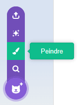
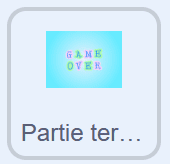
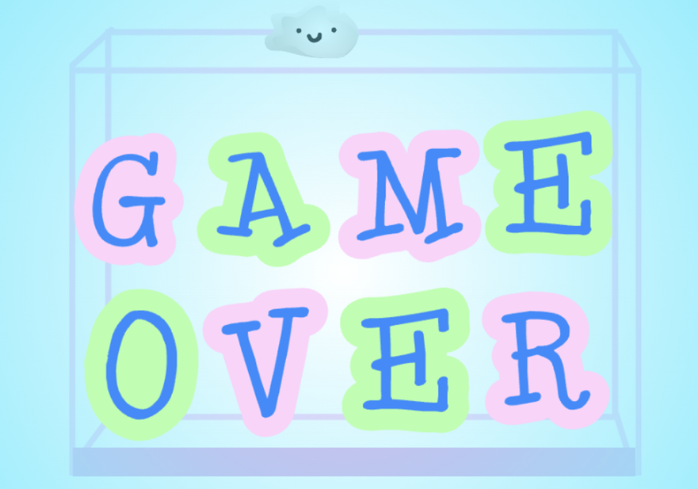

## Ajouter un message Game Over

La partie s'arrêtera lorsque la pile de fruits sera trop haute.

> [!TASK]
>
> {:width="150"}
>
> En bas, à l'intérieur de la boucle `répéter indéfiniment`{:class="block3control"}, ajoute un autre bloc `si`{:class="block3control"}.
>
> Utilise un bloc `plus de`{:class="block3operators"} et fais glisser le bloc `position y`{:class="block3motion"} dans la première case.
>
> ```blocks3
> if <(costume [number v]) = (3)> then
> if <touching color (#edd51c)?> then
> change y by (-4.2)
> wait (0.2) seconds
> start sound (Squish Pop v)
> delete this clone
> end
> end
> +if <(y position) > ()> then
> end
> ```

> [!TASK]
>
> Dans la deuxième case, indique le nombre qui correspond au point le plus haut souhaité.
>
> ```blocks3
> +if <(y position) > (111)> then
> end
> ```

> [!TASK]
>
> Si un fruit finit par dépasser ce nombre, `envoyer à tous et attendre`{:class="block3events"} un message `Game over`.
>
> ```blocks3
> if <(y position) > (111)> then
> +broadcast (Game over v) and wait
> end
> ```

> [!TASK]
>
> Crée un nouveau sprite avec l’outil Peindre et dessine ton écran Game Over.
>
> {:width="200"}

> [!TASK]
>
> {:width="150"}
>
> Donne-lui un `drapeau vert`{:class="block3events"} qui le cache au début.
>
> ```blocks3
> when green flag clicked
> hide
> ```

> [!TASK]
>
> Ensuite, fais en sorte qu'il s'affiche lorsqu'il reçoit le message `Partie terminée`. Tu peux également ajouter un `son`{:class="block3sound"}.
>
> ```blocks3
> when I receive (Game over v)
> go to (front v) layer
> show
> play sound (Lose v) until done
> stop (all v)
> ```

**Test :** clique sur le drapeau vert et remplis la case jusqu'à ce que les fruits atteignent le haut. Ton écran 'Game Over' devrait apparaître et le jeu devrait s'arrêter.

{:width="450"}
