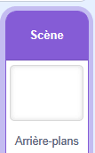

## Plus de défis

Tu as créé un jeu complet de lâcher de fruits. Voici d'autres façons de le personnaliser. Essaie celles qui te plaisent : chacune est facultative.

> [!TASK]
>
> ### Ajouter de la musique et un arrière-plan
>
> {:width="150"}
>
> Dans la scène, choisis un arrière-plan.
>
> Puis boucle un `son`{:class="block3sound"} pour que ton jeu ait une bande son.
>
> ```blocks3
> when green flag clicked
> forever
> play sound (your track v) until done
> end
> ```

> [!TASK]
>
> ### Ajouter un sprite de lâcher
>
> Ajoute un sprite en haut qui suit le pointeur de la souris, afin que le joueur puisse voir où le prochain fruit va atterrir. Le jeu d'exemple utilise un nuage. Tu peux lui ajouter des yeux et une bouche pour en faire un personnage.
>
> Tu peux utiliser le bloc `mettre x`{:class="block3motion"} pour cela.
>
> ```blocks3
> when green flag clicked
> go to x: (-8) y: (159)
> forever
> set x to (mouse x)
> end
> ```

> [!TASK]
>
> ### Ajouter une boîte ou un panier
>
> Dessine un sprite en forme de boîte ou de panier dans lequel les fruits pourront tomber, puis place-le à l’arrière-plan pour que les fruits semblent se trouver à l’intérieur.
>
> ```blocks3
> when green flag clicked
> go to (back v) layer
> ```

> [!TASK]
>
> ### Garder le score
>
> Ajoute une variable `score`{:class="block3variables"} pour en faire un jeu.
>
> Définis-le sur `0` lorsque le drapeau est cliqué, et `mettre à score`{:class="block3variables"} juste avant chaque `supprimer ce clone`{:class="block3control"}. Attribue des points différents à chaque fruit !
>
> ```blocks3
> change [score v] by (10)
> delete this clone
> ```


