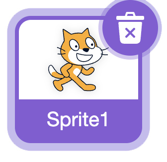
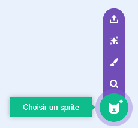
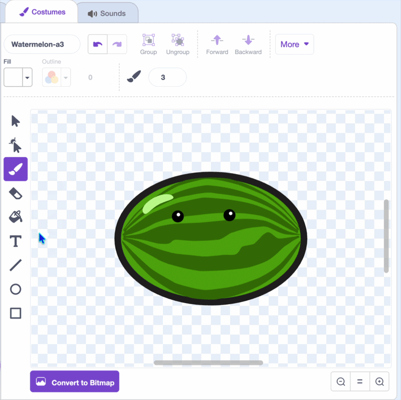
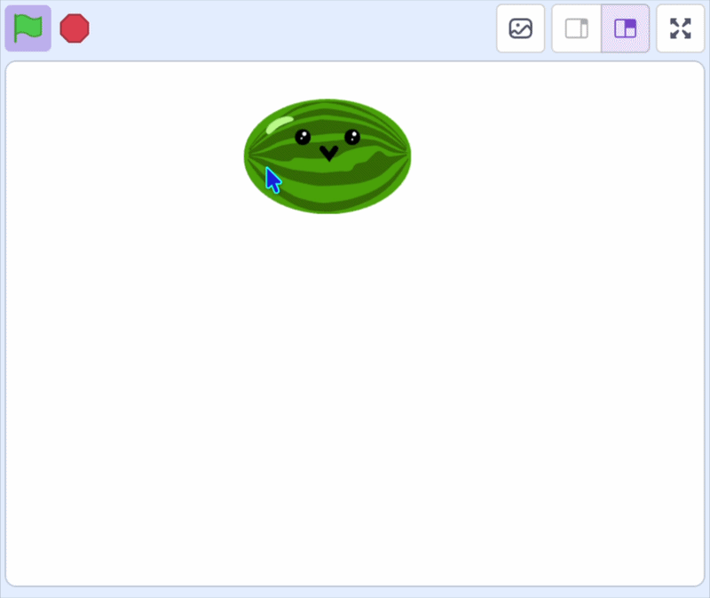

## Ajouter ton premier fruit

Dans cette étape, tu vas ajouter le premier fruit et le faire suivre le pointeur de la souris, prêt à tomber.

> [!TASK]
>
> [Démarrer un nouveau projet Scratch](https://scratch.mit.edu/projects/editor/){:target="_blank"}.

> [!TASK]
>
> Supprime le sprite de chat.
>
> {:width="200"}

> [!TASK]
>
> Choisis un nouveau sprite pour ton fruit. Tu peux en choisir un dans la bibliothèque ou le dessiner.
>
> {:width="200"}

> [!TASK]
>
> Utilise l'outil Peindre pour en faire un personnage : une paire d’yeux et une bouche. Redimensionne-le pour que plusieurs puissent tenir sur la scène.
>
> {:width="450"}

> [!TASK]
>
> {:width="150"}
>
> > Place ton fruit en haut de la scène.
> >
> > Sous le `drapeau vert`{:class="block3events"}, ajoute un bloc `mettre mode de glissement`{:class="block3sensing"} et choisis **non glissable** dans le menu déroulant afin que les joueurs ne puissent pas le déplacer. Ajoute ensuite un `aller à x: y:`{:class="block3motion"}.
>
> ```blocks3
> when green flag clicked
> set drag mode [not draggable v]
> go to x: (0) y: (115)
> ```

> [!TASK]
>
> Fais en sorte que le fruit suive le pointeur de la souris.
>
> Place le bloc `aller à x: y:` {:class="block3motion"} dans une boucle `répéter indéfiniment`{:class="block3control"}, puis remplace sa valeur **x** par la position `souris x`{:class="block3sensing"}.
>
> ```blocks3
> when green flag clicked
> set drag mode [not draggable v]
> +forever
> go to x: (mouse x) y: (115)
> end
> ```

> [!TASK]
>
> Ne déplace le fruit que lorsque tu maintiens le bouton de la souris enfoncé. Tout d'abord, enveloppe le bloc `aller à x: y:`{:class="block3motion"} dans un bloc `si () alors`{:class="block3control"}.
>
> ```blocks3
> when green flag clicked
> set drag mode [not draggable v]
> forever
> +if <> then
> go to x: (mouse x) y: (115)
> end
> end
> ```

> [!TASK]
>
> Maintenant, dépose un bloc `souris pressée ?`{:class="block3sensing"} dans la case hexagonale du bloc `si`{:class="block3control"}.
>
> ```blocks3
> when green flag clicked
> set drag mode [not draggable v]
> forever
> +if <mouse down?> then
> go to x: (mouse x) y: (115)
> end
> end
> ```

**Test :** clique sur le drapeau vert, puis sur la scène. Ton fruit suit le pointeur de la souris de gauche à droite, mais reste à la même hauteur.

{:width="450"}
