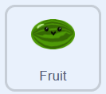
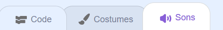
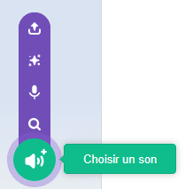
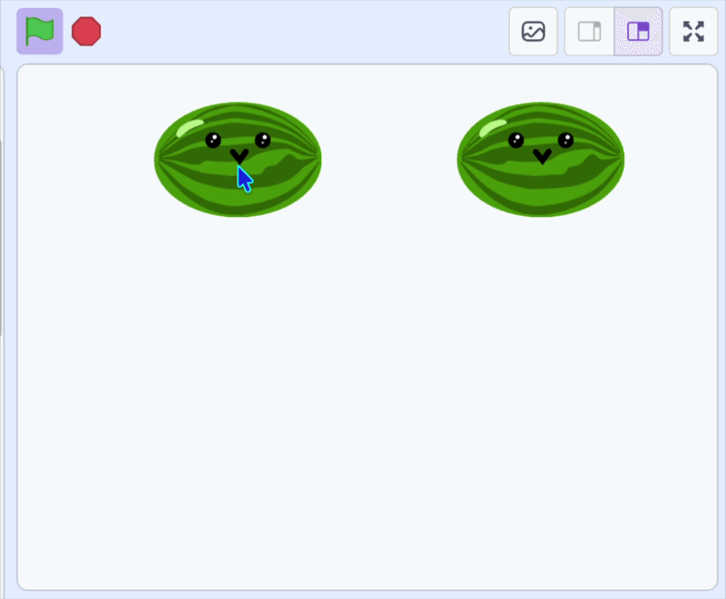

## Cloner le fruit

Les fruits que tu lâches sont des **clones**, c'est-à-dire des copies du sprite qui apparaissent à chaque clic de souris.

> [!TASK]
>
> {:width="150"}
>
> Ajoute un bloc `créer un clone`{:class="block3control"} qui crée une copie à chaque clic de souris. Il y a un `attendre` court{:class="block3control"} pour éviter que des centaines d'éléments n'apparaissent en même temps.
>
> Retire le bloc `aller à x: y:`{:class="block3motion"} : le clone l'utilisera ensuite.
>
> ```blocks3
> when green flag clicked
> set drag mode [not draggable v]
> forever
> if <mouse down?> then
> +create clone of (myself v)
> +wait (0.1) seconds
> end
> end
> ```

> [!TASK]
>
> Indique à chaque clone ce qu'il doit faire lorsqu'il apparaît.
>
> Ajoute un bloc `quand je commence comme un clone`{:class="block3control"} , puis replace le bloc de position `x: y:`{:class="block3motion"}.
>
> ```blocks3
> when I start as a clone
> go to x: (mouse x) y: (115)
> ```

> [!TASK]
>
> Choisis un son pour le moment où tu lâches le fruit.
>
> Commence par ajouter un nouveau son dans l'onglet **Sons**.
>
> {:width="450"}

> [!TASK]
>
> Clique sur « Choisir un son » et sélectionnes-en un dans la bibliothèque.
>
> {:width="200"}

> [!TASK]
>
> Ajoute ensuite un bloc `jouer le son`{:class="block3sound"} et sélectionne ton son dans le menu déroulant.
>
> ```blocks3
> when I start as a clone
> go to x: (mouse x) y: (115)
> +start sound (Pop v)
> ```

**Test :** clique sur le drapeau vert, puis sur la scène pour vérifier qu'un nouveau fruit apparaît avec un son pop.

{:width="450"}
