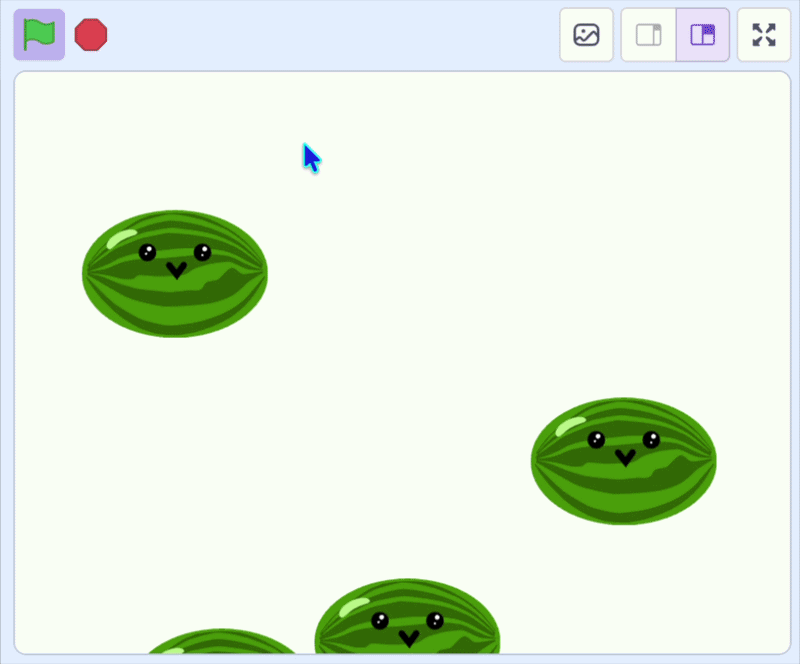

## Lâche les

Dans cette étape, tu vas lâcher le fruit vers le bas de l’écran.

> [!TASK]
>
> {:width="150"}
>
> Ajoute une boucle `répéter indéfiniment`{:class="block3control"} dans `quand je commence comme un clone`{:class="block3control"} et fais-le tomber en ajoutant à `y`{:class="block3motion"}.
>
> ```blocks3
> when I start as a clone
> go to x: (mouse x) y: (115)
> start sound (Pop v)
> +forever
> change y by (-4)
> end
> ```

**Test :** clique sur le drapeau vert et essaie de lâcher des fruits. Tes fruits devraient tomber, mais le fruit d'origine devrait également rester visible en haut.

> [!TASK]
>
> Ajoute les blocs `cacher`{:class="block3looks"} et `montrer`{:class="block3looks"} pour que seuls les clones s'affichent.
>
> Cache le fruit d'origine :
>
> ```blocks3
> when green flag clicked
> set drag mode [not draggable v]
> +hide
> forever
> if <mouse down?> then
> create clone of (myself v)
> wait (0.1) seconds
> end
> end
> ```
>
> Et fais apparaître le nouveau clone.
>
> ```blocks3
> when I start as a clone
> go to x: (mouse x) y: (115)
> start sound (Pop v)
> +show
> forever
> change y by (-4)
> end
> ```

**Test :** clique sur le drapeau vert et lâche des fruits. Vérifie que chaque fruit tombe bien le long de l'écran et que le fruit d'origine est bien caché.

{:width="450"}
