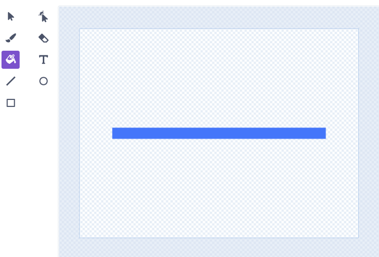
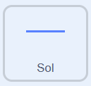
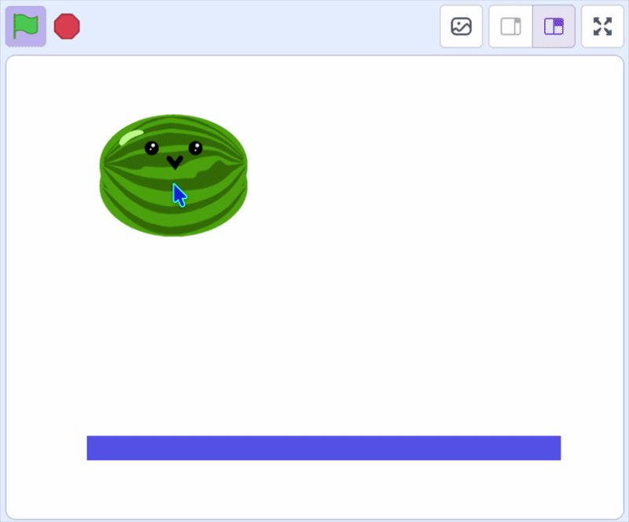

## Les faire atterrir

Ajoute un sol et fais en sorte que le fruit atterrisse dessus.

> [!TASK]
>
> Dans l'icône Choisir un sprite, choisis **Peindre** pour dessiner un nouveau sprite et nomme-le **Sol**.
>
> {:width="200"}

> [!TASK]
>
> Utilise les outils d'édition pour tracer une ligne ou un rectangle plein au milieu de la zone de peinture. Ce sera le sol sur lequel reposeront tes fruits.
>
> {:width="450"}

> [!TASK]
>
> {:width="150"}
>
> Déplace le sprite **Sol** en bas de la scène.
>
> Ajoute un bloc `drapeau vert`{:class="block3events"}, avec un bloc `mettre mode de glissement`{:class="block3sensing"}, et un bloc `aller à x: y:`{:class="block3motion"} pour le placer à l'endroit où tu l'as positionné.
>
> ```blocks3
> when green flag clicked
> set drag mode [not draggable v]
> go to x: (0) y: (-125)
> ```

> [!TASK]
>
> {:width="150"}
>
> Clique sur le sprite du **fruit**, ajoute un bloc `si`{:class="block3control"} pour vérifier si le clone `touche`{:class="block3sensing"} le sol. S'il touche le sol, il se déplacera vers le haut en `ajoutant`{:class="block3motion"} à **y**.
>
> ```blocks3
> forever
> change y by (-4)
> +if <touching (Floor v)?> then
> change y by (4.1)
> end
> end
> ```
>
> > [!TIP]
> >
> > Le fruit tombe de 4 à chaque fois, puis remonte de 4,1 lorsqu'il touche le sol. Ces deux nombres s'annulent presque, ce qui donne l'impression que le fruit vacille.

**Test :** clique sur le drapeau vert et vérifie que le fruit tombe et atterrit sur le sol.

{:width="450"}
