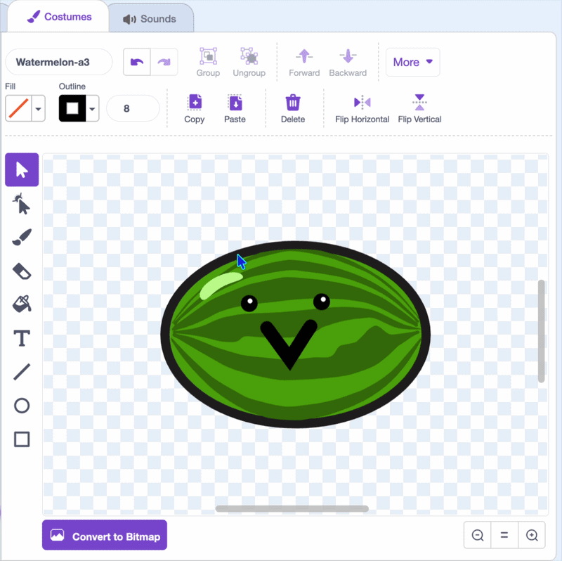
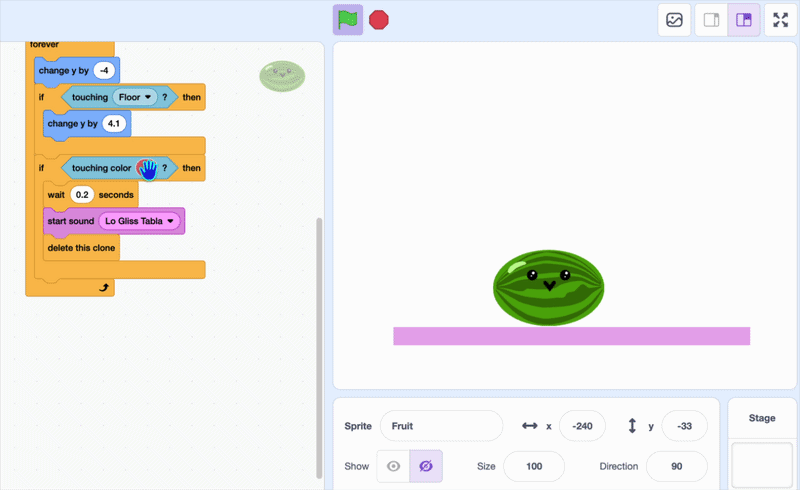
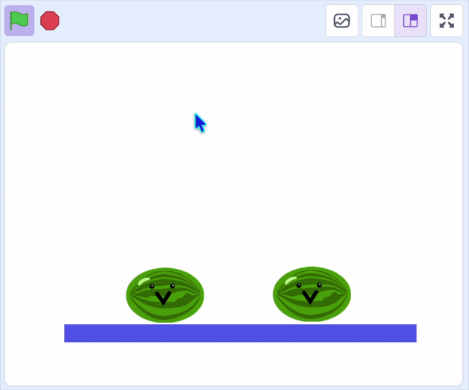

## Faire disparaître le fruit

Passons maintenant à la partie interactive !

Dans cette étape, utilise `couleur touchée ?`{:class="block3sensing"} pour faire disparaître les fruits s'ils se touchent.

> [!TASK]
>
> {:width="150"}
>
> Dans l'**éditeur de peinture**, modifie le contour de ton **sprite fruit** pour qu'il corresponde à la couleur principale du fruit, ou dessine un contour d'une seule couleur tout autour.
>
> {:width="450"}

> [!TASK]
>
> Ajoute `si`{:class="block3control"} et `couleur touchée ?`{:class="block3sensing"} à l'intérieur de la boucle `répéter indéfiniment`{:class="block3control"}.
>
> ```blocks3
> when I start as a clone
> go to x: (mouse x) y: (115)
> start sound (Pop v)
> show
> forever
> change y by (-4)
> if <touching (Floor v)?> then
> change y by (4.1)
> end
> +if <touching color ()?> then
> end
> end
> ```

> [!TASK]
>
> Pour obtenir la couleur exacte, clique sur la case de couleur dans `couleur touchée ?`{:class="block3sensing"} et choisis la pipette pour sélectionner ton fruit.
>
> {:width="450"}

> [!TASK]
>
> Ajoute `ajouter à y`{:class="block3motion"} et `attendre`{:class="block3control"} afin que les fruits se déplacent et attendent un moment pour détecter les couleurs.
>
> ```blocks3
> forever
> change y by (-4)
> if <touching (Floor v)?> then
> change y by (4.1)
> end
> if <touching color (#4e9a06)?> then
> +change y by (-4.2)
> +wait (0.2) seconds
> end
> end
> ```

> [!TASK]
>
> Ajoute un bloc `jouer le son`{:class="block3sound"} et choisis un son qui accompagne ton fruit.
>
> ```blocks3
> forever
> change y by (-4)
> if <touching (Floor v)?> then
> change y by (4.1)
> end
> if <touching color (#4e9a06)?> then
> change y by (-4.2)
> wait (0.2) seconds
> +start sound (Lo Gliss Tabla v)
> end
> end
> ```

> [!TASK]
>
> Ensuite, fais disparaître les deux clones avec `supprimier ce clone`{:class="block3control"}.
>
> ```blocks3
> forever
> change y by (-4)
> if <touching (Floor v)?> then
> change y by (4.1)
> end
> if <touching color (#4e9a06)?> then
> change y by (-4.2)
> wait (0.2) seconds
> start sound (Lo Gliss Tabla v)
> +delete this clone
> end
> end
> ```

**Test :** clique sur le drapeau vert et lâches deux fruits au même endroit. Lorsqu'ils se touchent, ils devraient émettre un son et disparaître.

{:width="450"}

