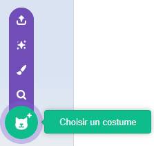
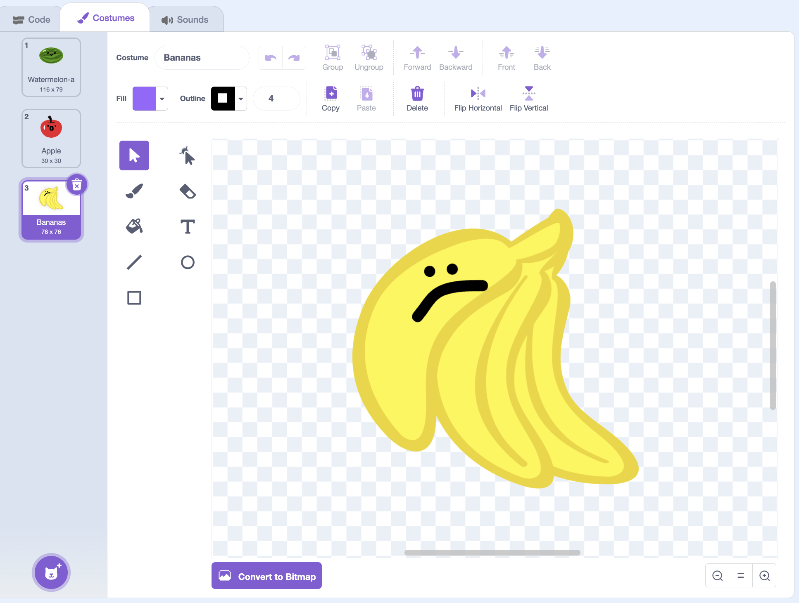

## Ajouter plus de fruits

Dans cette étape, tu ajouteras plus de fruits !

> [!TASK]
>
> {:width="150"}
>
> Clique sur l'onglet **Costumes** de ton sprite fruit.
>
> {:width="450"}

> [!TASK]
>
> Ajoute un nouveau costume pour chaque nouveau type de fruit que tu veux. Pour faire simple, essaie d'en ajouter un ou deux de plus pour commencer.
>
> {:width="200"}

> [!TASK]
>
> Assure-toi que les nouveaux fruits aient un **contour uniforme d'une seule couleur** tout autour, tout comme tes premiers fruits.
>
> {:width="450"}

> [!TIP]
>
> Si ton sprite possède des costumes supplémentaires dont tu n’as pas besoin, supprime-les. Sinon, ils se retrouveront aussi dans le jeu.

> [!TASK]
>
> Ajoute maintenant un `basculer sur le costume`{:class="block3looks"} et fais glisser le bloc `nombre aléatoire`{:class="block3operators"}. Cela choisira un numéro de costume aléatoire à chaque fois, de sorte qu'un fruit différent apparaisse.
>
> ```blocks3
> when I start as a clone
> +switch costume to (pick random (1) to (3))
> go to x: (mouse x) y: (115)
> start sound (Pop v)
> show
> forever
> change y by (-4)
> if <touching (Floor v)?> then
> change y by (4.1)
> end
> if <touching color (#4e9a06)?> then
> change y by (-4.2)
> wait (0.2) seconds
> start sound (Lo Gliss Tabla v)
> delete this clone
> end
> end
> ```
>
> Saisis les nombres aléatoires correspondant au nombre de costumes que tu as.

**Test :** clique sur le drapeau vert et clique avec la souris pour vérifier si un de tes fruits apparaît au hasard à chaque fois.
