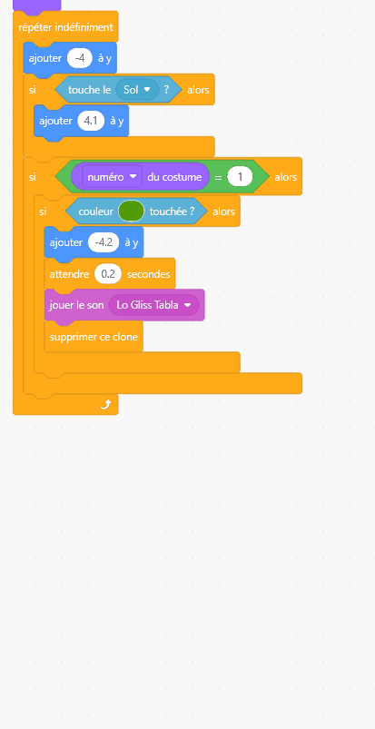
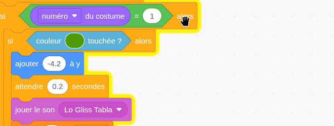

## Faire disparaître les fruits

Dans cette étape, tu feras disparaître chaque fruit lorsqu'il correspondra.

> [!TASK]
>
> {:width="150"}
>
> Ajoute un autre bloc `si`{:class="block3control"} et déplaces-y le bloc `si`{:class="block3control"} avec `couleur touchée ?`{:class="block3sensing"}.
>
> ```blocks3
> when I start as a clone
> switch costume to (pick random (1) to (3))
> go to x: (mouse x) y: (115)
> start sound (Pop v)
> show
> forever
> change y by (-4)
> if <touching (Floor v)?> then
> change y by (4.1)
> end
> +if < > then
> if <touching color (#4e9a06)?> then
> change y by (-4.2)
> wait (0.2) seconds
> start sound (Lo Gliss Tabla v)
> delete this clone
> end
> end
> end
> ```

> [!TASK]
>
> {:width="150"}
>
> Utilise un `égal`{:class="block3operators"} et fais glisser le `numéro du costume`{:class="block3looks"}. Cela permettra de vérifier si le numéro du costume est `1`.
>
> ```blocks3
> forever
> change y by (-4)
> if <touching (Floor v)?> then
> change y by (4.1)
> end
> +if <(costume [number v]) = (1)> then
> if <touching color (#4e9a06)?> then
> change y by (-4.2)
> wait (0.2) seconds
> start sound (Lo Gliss Tabla v)
> delete this clone
> end
> end
> end
> ```

> [!TASK]
>
> Fais un clic droit et **duplique** le bloc, afin de pouvoir l'ajouter pour tous les fruits. Les nouveaux blocs doivent se trouver sous le dernier, et à l'intérieur du `répéter indéfiniment`{:class="block3control"}.
>
> {:width="450"}

> [!TASK]
>
> Remplace `égal`{:class="block3operators"} par `2` et utilise la pipette pour la couleur de ton **deuxième** costume. Tu peux également choisir un autre son si tu le souhaites.
>
> ```blocks3
> forever
> change y by (-4)
> if <touching (Floor v)?> then
> change y by (4.1)
> end
> if <(costume [number v]) = (1)> then
> if <touching color (#4e9a06)?> then
> change y by (-4.2)
> wait (0.2) seconds
> start sound (Lo Gliss Tabla v)
> delete this clone
> end
> end
> +if <(costume [number v]) = (2)> then
> if <touching color (#ec1c2c)?> then
> change y by (-4.2)
> wait (0.2) seconds
> start sound (Chomp v)
> delete this clone
> end
> end
> end
> ```

> [!TASK]
>
> Puis duplique une fois de plus pour ton **troisième** fruit. Ajoute `égal`{:class="block3operators"} à `3`, et utilise la pipette pour sélectionner cette couleur.
>
> ```blocks3
> +if <(costume [number v]) = (3)> then
> if <touching color (#edd51c)?> then
> change y by (-4.2)
> wait (0.2) seconds
> start sound (Squish Pop v)
> delete this clone
> end
> end
> ```

> [!TIP]
>
> Il est facile de s’y perdre parmi tous les blocs. Fais un clic droit et choisis **Ajouter un commentaire** pour indiquer le nom du fruit correspondant à chaque fruit.

{:width="450"}

Clique sur le drapeau vert pour **tester**. Chaque fruit doit disparaître lorsqu'il touche un autre fruit de la même couleur.
