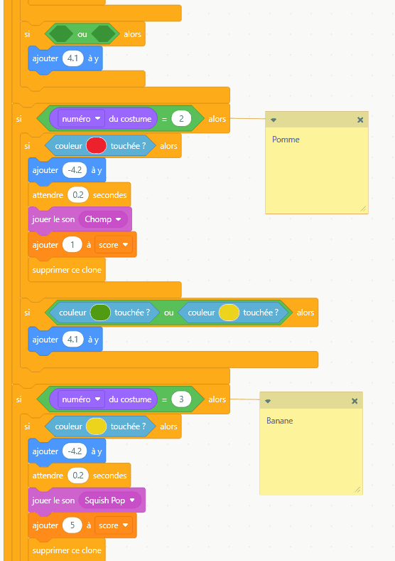
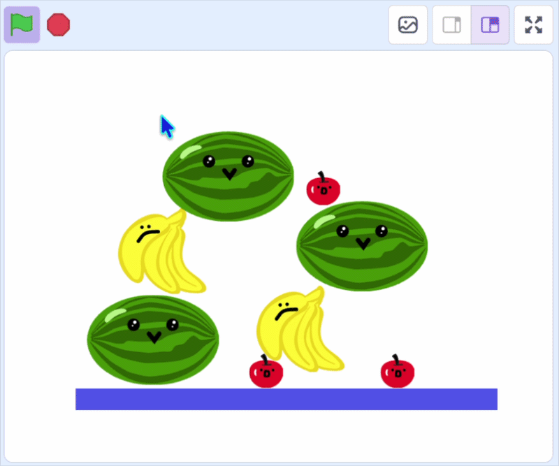

## Empiler les fruits

Dans cette étape, tu empileras les fruits qui ne correspondent pas, afin que la boîte puisse se remplir.

> [!TASK]
>
> {:width="150"}
>
> Pour le premier costume fruit, ajoute un autre bloc `si`{:class="block3control"} à l'intérieur de la vérification `numéro du costume`{:class="block3looks"}.
>
> ```blocks3
> if <(costume [number v]) = (1)> then
> if <touching color (#4e9a06)?> then
> change y by (-4.2)
> wait (0.2) seconds
> start sound (Lo Gliss Tabla v)
> delete this clone
> end
> +if <> then
> end
> end
> ```

> [!TASK]
>
> Fais glisser sur un bloc `ou`{:class="block3operators"}.
>
> ```blocks3
> if <(costume [number v]) = (1)> then
> if <touching color (#4e9a06)?> then
> change y by (-4.2)
> wait (0.2) seconds
> start sound (Lo Gliss Tabla v)
> delete this clone
> end
> +if <<> or <>> then
> end
> end
> ```

> [!TASK]
>
> Ajoute ensuite des blocs `couleur touchée ?`{:class="block3sensing"} pour **tous tes autres fruits**.
>
> ```blocks3
> if <(costume [number v]) = (1)> then
> if <touching color (#4e9a06)?> then
> change y by (-4.2)
> wait (0.2) seconds
> start sound (Lo Gliss Tabla v)
> delete this clone
> end
> +if <<touching color (#ec1c2c)?> or <touching color (#edd51c)?>> then
> end
> end
> ```
>
> Pour être sûr d'obtenir les bonnes couleurs, tu peux dupliquer les blocs de couleur que tu as réalisés à l'étape précédente.
>
> {:width="350"}

> [!TASK]
>
> Ensuite, `ajouter à y`{:class="block3motion"} pour que les fruits s'empilent sur d'autres fruits de la même manière qu'avec le **sol**.
>
> ```blocks3
> if <(costume [number v]) = (1)> then
> if <touching color (#4e9a06)?> then
> change y by (-4.2)
> wait (0.2) seconds
> start sound (Lo Gliss Tabla v)
> delete this clone
> end
> if <<touching color (#ec1c2c)?> or <touching color (#edd51c)?>> then
> +change y by (4.1)
> end
> end
> ```

> [!TASK]
>
> Fais la même chose pour tes deux autres costumes, en changeant les deux couleurs pour les **deux autres** fruits.

> [!TIP]
>
> Si tu utilises plus de 3 fruits, tu devras ajouter les blocs `couleur`{:class="block3sensing"} pour chaque fruit supplémentaire. Tu peux intégrer plus de blocs `ou`{:class="block3operators"} pour faire cela.

**Test :** clique sur le drapeau vert pour voir si différents fruits s'empilent maintenant en tas, et si les fruits identiques disparaissent toujours.

{:width="450"}
