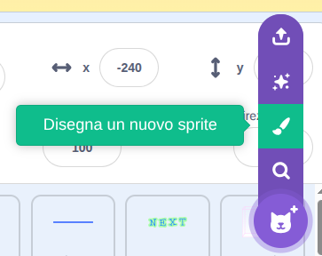
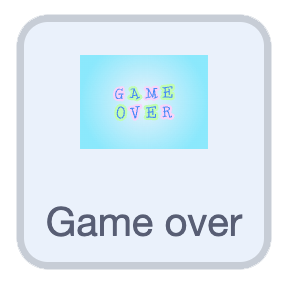
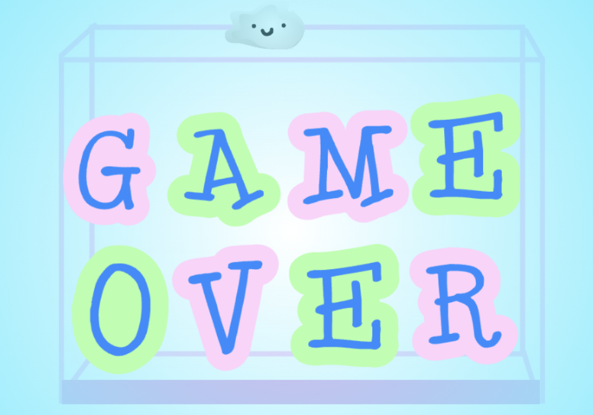

## Aggiungi un game over

Fai terminare il gioco quando la pila di frutta diventa troppo alta.

> [!TASK]
>
> {:width="150"}
>
> In fondo, all'interno del ciclo `per sempre`{:class="block3control"}, aggiungi un altro blocco `se`{:class="block3control"}.
>
> Utilizza un blocco `more than`{:class="block3operators"} e trascina la `posizione y`{:class="block3motion"} nella prima casella.
>
> ```blocks3
> if <(costume [numero v]) = (3)> then
> if <touching color (#edd51c)?> then
> change y by (-4.2)
> wait (0.2) seconds
> start sound (Squish Pop v)
> delete this clone
> end
> end
> +if <(y position) > ()> then
> end
> ```

> [!TASK]
>
> Nella seconda casella, inserisci il numero che desideri rappresenti il punto più alto.
>
> ```blocks3
> +if <(y position) > (111)> then
> end
> ```

> [!TASK]
>
> Se un frutto finisce per essere più alto di questo numero, trasmette e attendi un messaggio di "Game Over".
>
> ```blocks3
> if <(y position) > (111)> then
> +broadcast (Game over v) and wait
> end
> ```

> [!TASK]
>
> Crea un nuovo sprite e disegna la schermata di **game over**.
>
> {:width="200"}

> [!TASK]
>
> {:width="150"}
>
> Assegnagli una `bandiera verde`{:class="block3events"} che lo nasconda all'avvio.
>
> ```blocks3
> when green flag clicked
> hide
> ```

> [!TASK]
>
> Quindi, fallo apparire quando viene visualizzato il messaggio "Game over". È possibile aggiungere anche un `suono`{:class="block3sound"}.
>
> ```blocks3
> when I receive (Game over v)
> go to (primo v) layer
> show
> play sound (Lose v) until done
> stop (tutto v)
> ```

**Test:** Clicca sulla bandierina verde e riempi la casella finché la frutta non raggiunge la cima: dovrebbe apparire la schermata "Game over" e il gioco dovrebbe terminare.

{:width="450"}
