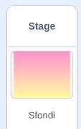

## Più sfide

Hai creato un gioco completo in cui devi far cadere la frutta. Ecco altri modi per personalizzarlo. Provate quelli che preferite: ognuno è facoltativo.

> [!TASK]
>
> ### Aggiungi musica e sottofondo
>
> {:width="150"}
>
> Nello sfondo, scegli uno sfondo.
>
> Quindi riproduci in loop una traccia `suono`{:class="block3sound"} in modo che il tuo gioco abbia una colonna sonora.
>
> ```blocks3
> when green flag clicked
> forever
> play sound (la tua traccia v) until done
> end
> ```

> [!TASK]
>
> ### Aggiungi uno sprite del contagocce
>
> Aggiungi uno sprite nella parte superiore dello schermo che segua il puntatore del mouse, in modo che il giocatore possa vedere dove atterrerà il prossimo frutto. Il gioco di esempio utilizza una nuvola. Potresti dargli occhi e bocca per trasformarlo in un personaggio.
>
> Per questo puoi usare il blocco `vai dove x è`{:class="block3motion"}.
>
> ```blocks3
> when green flag clicked
> go to x: (-8) y: (159)
> forever
> set x to (x del mouse)
> end
> ```

> [!TASK]
>
> ### Aggiungi una scatola o un carrello
>
> Disegna una scatola o un cestino in cui far cadere la frutta e invialo sullo sfondo in modo che la frutta rimanga al suo interno.
>
> ```blocks3
> when green flag clicked
> go to (secondo v) layer
> ```

> [!TASK]
>
> ### Tenere il punteggio
>
> Aggiungi una variabile `punteggio`{:class="block3variables"} per renderlo più simile a un gioco.
>
> Impostalo a `0` quando si fa clic sulla bandiera e `modifica il punteggio di`{:class="block3variables"} appena prima di ogni `elimina questo clone`{:class="block3control"}. Assegna punteggi diversi a frutti diversi!
>
> ```blocks3
> change [punteggio v] by (10)
> delete this clone
> ```

***
Questo progetto è stato tradotto da volontari:

Omar Lazzari

Pierangela Trovato

Grazie ai volontari, possiamo offrire alle persone di tutto il mondo la possibilità di imparare nella loro lingua. Puoi aiutarci a raggiungere più persone offrendoti come volontario per la traduzione - puoi trovare maggiori informazioni su [rpf.io/translate](https://rpf.io/translate).
