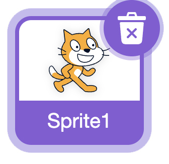
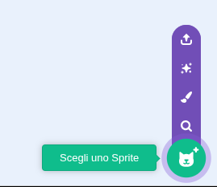
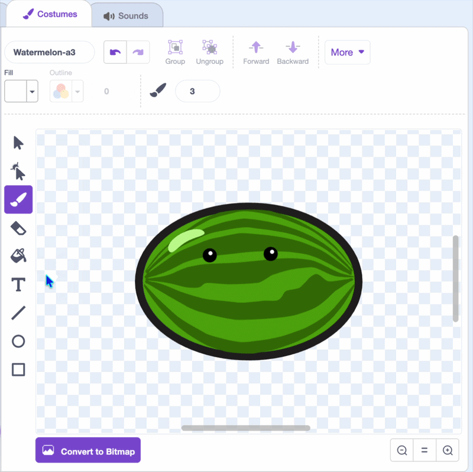
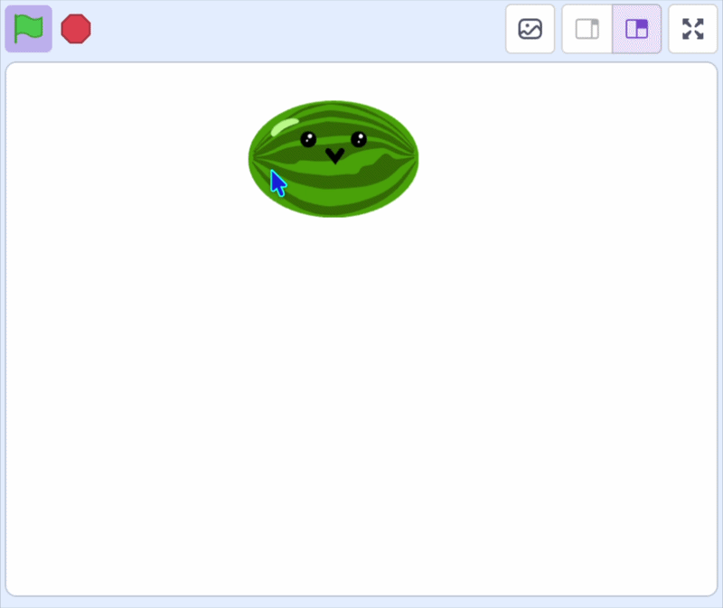

## Aggiungi il tuo primo frutto

In questo passaggio, aggiungerai il primo frutto e gli farai seguire il puntatore del mouse, pronto per essere rilasciato.

> [!TASK]
>
> [Avvia un nuovo progetto Scratch](https://scratch.mit.edu/projects/editor/){:target="_blank"}.

> [!TASK]
>
> Cancella lo sprite del gatto.
>
> {:width="200"}

> [!TASK]
>
> Scegli un nuovo sprite per la tua frutta. Puoi sceglierne uno dalla galleria oppure disegnarne uno tu stesso.
>
> {:width="200"}

> [!TASK]
>
> Usa gli strumenti di pittura per dargli un po' di carattere: un paio di occhi e una bocca. Ridimensionalo in modo che alcuni possano stare sullo stage.
>
> {:width="450"}

> [!TASK]
>
> {:width="150"}
>
> > Posizionate la frutta vicino alla parte superiore dello stage.
> >
> > Sotto la `bandiera verde`{:class="block3events"}, aggiungi un blocco `rendi lo sprite`{:class="block3sensing"} e scegli **non trascinabile** dal menu a tendina in modo che i giocatori non possano trascinarlo. Quindi aggiungi `vai a x: y:`{:class="block3motion"}.
>
> ```blocks3
> when green flag clicked
> set drag mode [non trascinabile v]
> go to x: (0) y: (115)
> ```

> [!TASK]
>
> Fai in modo che la frutta segua il puntatore del mouse.
>
> Avvolgi il blocco `vai a x: y:`{:class="block3motion"} in un ciclo `per sempre`{:class="block3control"} e cambia la sua posizione **x**{:class="block3motion"} con la posizione `x del mouse`{:class="block3sensing"}.
>
> ```blocks3
> when green flag clicked
> set drag mode [non trascinabile v]
> +forever
> go to x: (mouse x) y: (115)
> end
> ```

> [!TASK]
>
> Sposta la frutta solo tenendo premuto il pulsante del mouse. Innanzitutto, racchiudi il blocco `vai a x: y:`{:class="block3motion"} in un blocco `se () allora`{:class="block3control"}.
>
> ```blocks3
> when green flag clicked
> set drag mode [non trascinabile v]
> forever
> +if <> then
> go to x: (mouse x) y: (115)
> end
> end
> ```

> [!TASK]
>
> Ora trascina un blocco `pulsante del mouse premuto`{:class="block3sensing"} nello slot esagonale del blocco `se`{:class="block3control"}.
>
> ```blocks3
> when green flag clicked
> set drag mode [non trascinabile v]
> forever
> +if <mouse down?> then
> go to x: (mouse x) y: (115)
> end
> end
> ```

**Test:** Clicca sulla bandierina verde, poi clicca sullo stage. Il frutto segue il puntatore del mouse a sinistra e a destra, ma rimane alla stessa altezza.

{:width="450"}
