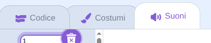
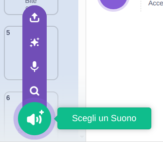
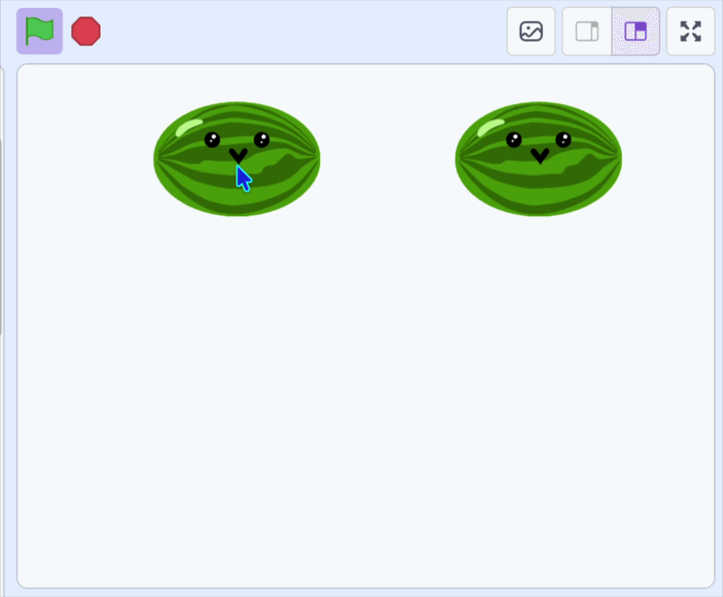

## Clona il frutto

I frutti che lasci cadere sono **cloni**, ovvero copie dello sprite che appare ogni volta che si clicca con il mouse.

> [!TASK]
>
> {:width="150"}
>
> Aggiungi un blocco `crea clone di`{:class="block3control"} che crea una copia ogni volta che si fa clic con il mouse. C'è un breve `attendi`{:class="block3control"} in modo che non ne appaiano centinaia contemporaneamente.
>
> Rimuovi il blocco `vai a x: y:`{:class="block3motion"} — il clone lo utilizzerà in seguito.
>
> ```blocks3
> when green flag clicked
> set drag mode [non trascinabile v]
> forever
> if <mouse down?> then
> +create clone of (me stesso v)
> +wait (0.1) seconds
> end
> end
> ```

> [!TASK]
>
> Spiega a ciascun clone cosa fare quando appare.
>
> Aggiungi un blocco `quando avvio come clone`{:class="block3control"} e trascinalo nella posizione `x: y:`{:class="block3motion"}.
>
> ```blocks3
> when I start as a clone
> go to x: (x del mouse) y: (115)
> ```

> [!TASK]
>
> Scegli un suono da riprodurre quando fai cadere il frutto.
>
> Innanzitutto, aggiungi un nuovo suono nella **scheda Suoni**.
>
> {:width="450"}

> [!TASK]
>
> Fai clic su "Scegli un suono" e selezionane uno dalla libreria.
>
> {:width="200"}

> [!TASK]
>
> Quindi aggiungi un blocco `avvia la riproduzione`{:class="block3sound"} e seleziona il suono dal menu a tendina.
>
> ```blocks3
> when I start as a clone
> go to x: (x del mouse) y: (115)
> +start sound (Pop v)
> ```

**Test:** clicca sulla bandierina verde, poi clicca sul palco per verificare che appaia un nuovo frutto con un suono scoppiettante.

{:width="450"}
