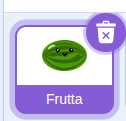
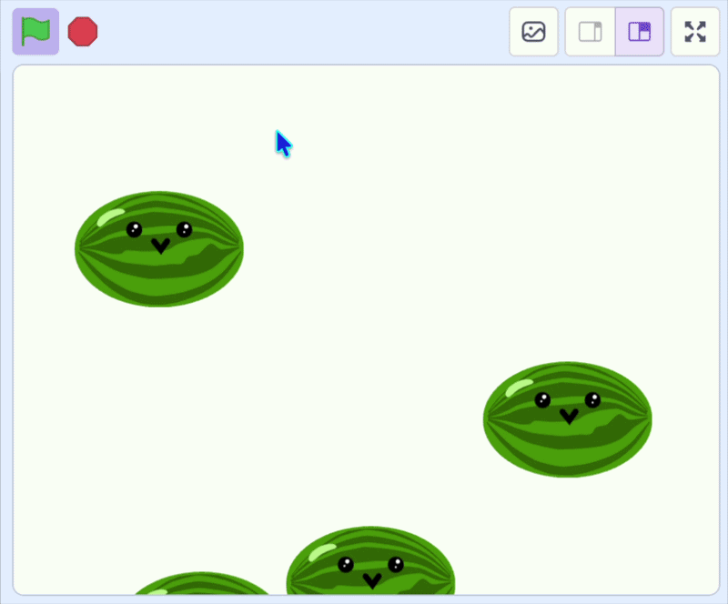

## Lasciali cadere

In questo passaggio, farai cadere la frutta sullo schermo.

> [!TASK]
>
> {:width="150"}
>
> Aggiungi un ciclo `per sempre`{:class="block3control"} in `quando vengo clonato`{:class="block3control"} e fallo cadere modificando la posizione `y`{:class="block3motion"}.
>
> ```blocks3
> when I start as a clone
> go to x: (x del mouse) y: (115)
> start sound (Pop v)
> +forever
> change y by (-4)
> end
> ```

**Test:** Clicca sulla bandierina verde e prova a far cadere della frutta. Il frutto dovrebbe cadere, ma il frutto originale dovrebbe comunque rimanere visibile in cima.

> [!TASK]
>
> Aggiungi i blocchi `nascondi`{:class="block3looks"} e `mostra`{:class="block3looks"} per visualizzare solo i cloni.
>
> Nascondi il frutto originale:
>
> ```blocks3
> when green flag clicked
> set drag mode [non trascinabile v]
> +hide
> forever
> if <pulsante del mouse premuto> then
> create clone of (me stesso v)
> wait (0.1) seconds
> end
> end
> ```
>
> E far appaire il nuovo clone.
>
> ```blocks3
> when I start as a clone
> go to x: (x del mouse) y: (115)
> start sound (Pop v)
> +show
> forever
> change y by (-4)
> end
> ```

**Test:** Clicca sulla bandierina verde e lascia cadere della frutta. Verifica che ogni pezzo cada sullo schermo e che il frutto originale sia nascosto.

{:width="450"}
