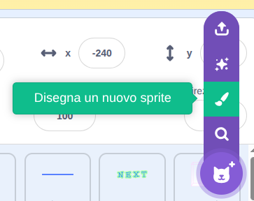
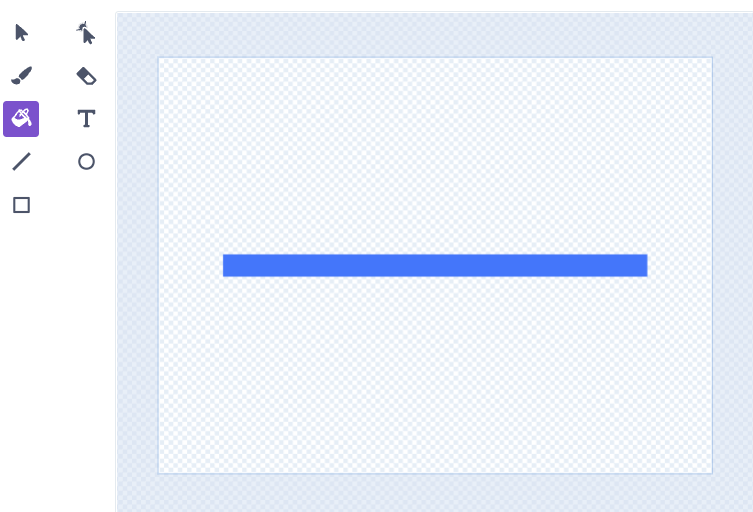
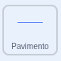
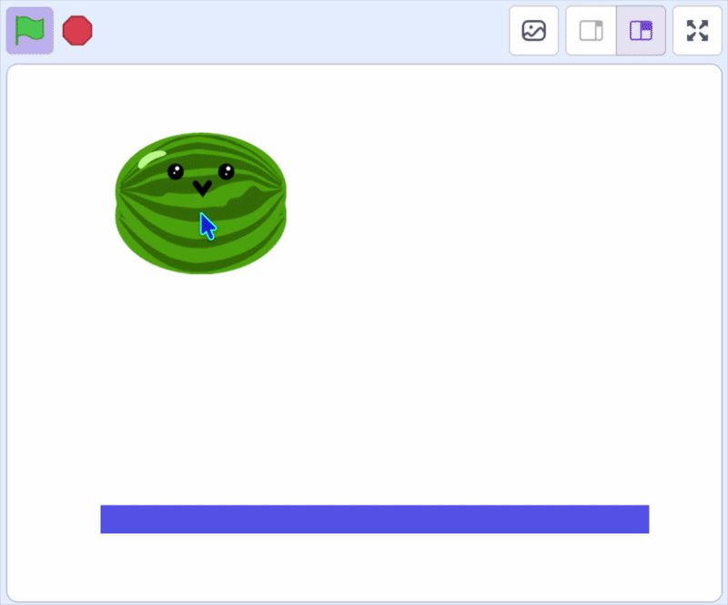

## Farli atterrare

Aggiungi un pavimento e fai in modo che la frutta atterri su di esso.

> [!TASK]
>
> Nell'icona "Aggiungi sprite", scegli **Disegna** per disegnare un nuovo sprite e chiamalo **Pavimento**.
>
> {:width="200"}

> [!TASK]
>
> Utilizza gli strumenti di modifica per disegnare una linea o un rettangolo pieno al centro dell'area di disegno. Questo sarà il pavimento su cui poggerà la tua frutta.
>
> {:width="450"}

> [!TASK]
>
> {:width="150"}
>
> Sposta lo sprite **Pavimento** nella parte inferiore del palco.
>
> Aggiungi un blocco `bandierina verde`{:class="block3events"}, con un blocco `imposta modalità di trascinamento`{:class="block3sensing"} e un blocco `vai a x: y:`{:class="block3motion"} per posizionarlo dove lo hai posizionato.
>
> ```blocks3
> when green flag clicked
> set drag mode [not draggable v]
> go to x: (0) y: (-125)
> ```

> [!TASK]
>
> {:width="150"}
>
> Fai clic sullo sprite della **frutta**, aggiungi un blocco `se`{:class="block3control"} per verificare se il clone sta `toccando`{:class="block3sensing"} il pavimento. Se tocca il pavimento, si sposterà verso l'alto `cambiando`{:class="block3motion"} la **y**.
>
> ```blocks3
> forever
> change y by (-4)
> +if <touching (Floor v)?> then
> change y by (4.1)
> end
> end
> ```
>
> > [!TIP]
> >
> > Il frutto cade di 4 ogni volta, poi salta di nuovo verso l'alto di 4,1 quando tocca il pavimento. Quei due numeri si annullano quasi a vicenda, quindi il frutto sembra ondeggiare.

**Test:** Clicca sulla bandierina verde e verifica che il frutto cada e atterri sul pavimento.

{:width="450"}
