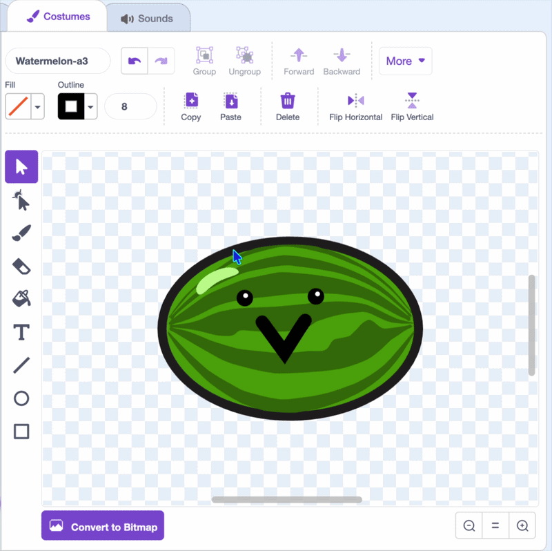
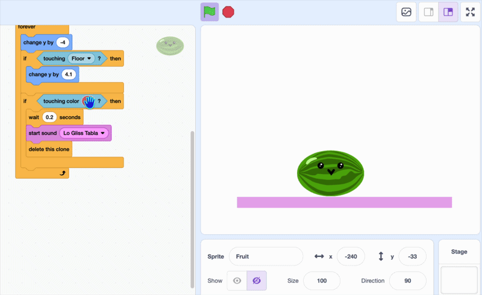
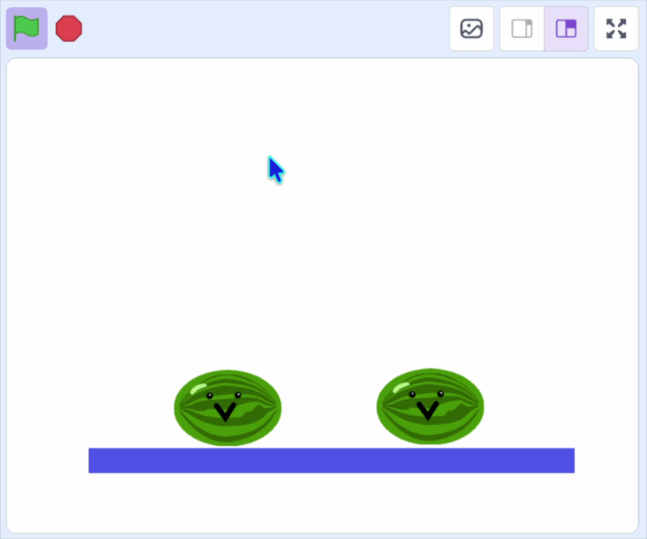

## Fai sparire la frutta

Ora passiamo alla parte interattiva!

In questo passaggio, usa il `sta toccando il colore`{:class="block3sensing"} per far scomparire i frutti se si toccano.

> [!TASK]
>
> {:width="150"}
>
> Nell'editor per disegnare, modifica il contorno del tuo **fantasma della frutta** in modo che corrisponda al colore principale della frutta, oppure disegna un contorno di un unico colore lungo tutto il bordo.
>
> {:width="450"}

> [!TASK]
>
> Aggiungi `se`{:class="block3control"} e `sta toccando il colore`{:class="block3sensing"} all'interno del ciclo `per sempre`{:class="block3control"}.
>
> ```blocks3
> when I start as a clone
> go to x: (mouse x) y: (115)
> start sound (Pop v)
> show
> forever
> change y by (-4)
> if <touching (Pavimento v)?> then
> change y by (4.1)
> end
> +if <touching color ()?> then
> end
> end
> ```

> [!TASK]
>
> Per ottenere il colore esatto, fai clic sulla casella del colore in `sta toccando il colore`{:class="block3sensing"} e scegli il contagocce per selezionarlo dal tuo frutto.
>
> {:width="450"}

> [!TASK]
>
> Aggiungi `cambia y`{:class="block3motion"} e `attendi`{:class="block3control"} in modo che entrambi i frutti si muovano e attendano un momento per rilevare i colori.
>
> ```blocks3
> forever
> change y by (-4)
> if <touching (Pavimento v)?> then
> change y by (4.1)
> end
> if <touching color (#4e9a06)?> then
> +change y by (-4.2)
> +wait (0.2) seconds
> end
> end
> ```

> [!TASK]
>
> Aggiungi un blocco `avvia riproduzione`{:class="block3sound"} e scegli un suono da abbinare alla tua frutta.
>
> ```blocks3
> forever
> change y by (-4)
> if <touching (Pavimento v)?> then
> change y by (4.1)
> end
> if <touching color (#4e9a06)?> then
> change y by (-4.2)
> wait (0.2) seconds
> +start sound (Lo Gliss Tabla v)
> end
> end
> ```

> [!TASK]
>
> Quindi fai sparire entrambi i cloni con `elimina questo clone`{:class="block3control"}.
>
> ```blocks3
> forever
> change y by (-4)
> if <touching (Pavimento v)?> then
> change y by (4.1)
> end
> if <touching color (#4e9a06)?> then
> change y by (-4.2)
> wait (0.2) seconds
> start sound (Lo Gliss Tabla v)
> +delete this clone
> end
> end
> ```

**Test:** Clicca sulla bandierina verde e lascia cadere due frutti nello stesso punto. Quando si toccano, dovrebbero emettere un suono e scomparire.

{:width="450"}

