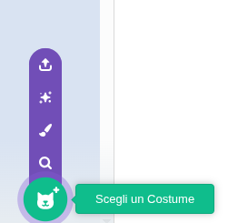
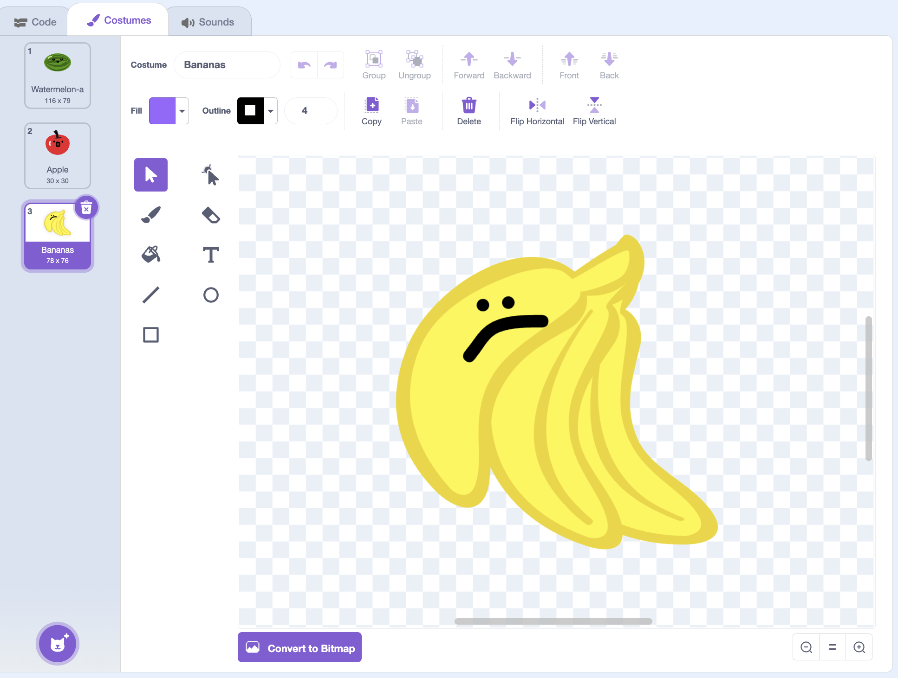

## Aggiungi altra frutta

In questa fase, aggiungerai altra frutta!

> [!TASK]
>
> {:width="150"}
>
> Fai clic sulla scheda **Costumi** del tuo sprite frutta.
>
> {:width="450"}

> [!TASK]
>
> Aggiungi un nuovo costume per ogni nuovo tipo di frutto che desideri. Per semplificare, prova ad aggiungerne uno o due in più all'inizio.
>
> {:width="200"}

> [!TASK]
>
> Assicurati che il nuovo frutto abbia un **contorno uniforme di un solo colore** tutt'intorno, proprio come il tuo primo frutto.
>
> {:width="450"}

> [!TIP]
>
> Se il tuo sprite include costumi extra che non desideri, eliminali. Altrimenti compariranno anche loro nel gioco.

> [!TASK]
>
> Ora aggiungi un `passa al costume`{:class="block3looks"} e trascina il blocco `numero a caso`{:class="block3operators"}. Questo sceglierà un numero di costume casuale ogni volta, in modo che appaia un frutto diverso.
>
> ```blocks3
> when I start as a clone
> +switch costume to (random (1) to (3))
> go to x: (mouse x) y: (115)
> start sound (Pop v)
> show
> forever
> change y by (-4)
> if <touching (Pavimento v)?> then
> change y by (4.1)
> end
> if <touching color (#4e9a06)?> then
> change y by (-4.2)
> wait (0.2) seconds
> start sound (Lo Gliss Tabla v)
> delete this clone
> end
> end
> ```
>
> Inserisci i numeri casuali corrispondenti al numero di costumi che possiedi.

**Test:** Clicca sulla bandierina verde e poi sul mouse per verificare se ogni volta compare un frutto a caso tra quelli che possiedi.
