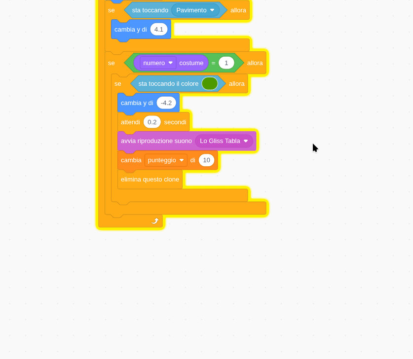
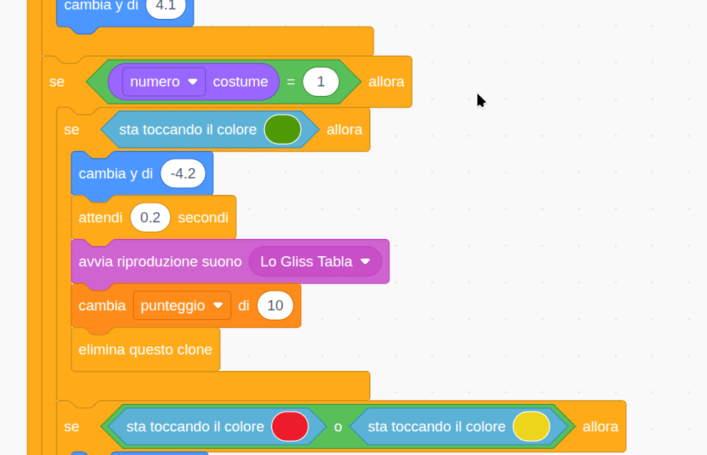

## Fai sparire ogni frutto

In questo passaggio, farai scomparire ogni frutto quando corrisponde.

> [!TASK]
>
> {:width="150"}
>
> Aggiungi un altro blocco `se`{:class="block3control"} e sposta al suo interno il blocco `se`{:class="block3control"} con `sta toccando il colore`{:class="block3sensing"}.
>
> ```blocks3
> when I start as a clone
> switch costume to (numero a caso (1) to (3))
> go to x: (x del mouse) y: (115)
> start sound (Pop v)
> show
> forever
> change y by (-4)
> if <sta toccando (Pavimento v)?> then
> change y by (4.1)
> end
> +if < > then
> if <sta toccando il colore (#4e9a06)?> then
> change y by (-4.2)
> wait (0.2) seconds
> start sound (Lo Gliss Tabla v)
> delete this clone
> end
> end
> end
> ```

> [!TASK]
>
> {:width="150"}
>
> Utilizza un `uguale`{:class="block3operators"} e trascina il `numero del costume`{:class="block3looks"}. Questo controllerà se il numero del costume è `1`.
>
> ```blocks3
> forever
> change y by (-4)
> if <sta toccando (Pavimento v)?> then
> change y by (4.1)
> end
> +if <(costume [numero v]) = (1)> then
> if <sta toccando il colore (#4e9a06)?> then
> change y by (-4.2)
> wait (0.2) seconds
> start sound (Lo Gliss Tabla v)
> delete this clone
> end
> end
> end
> ```

> [!TASK]
>
> Fai clic con il pulsante destro del mouse e **duplica** il blocco, in modo da poterlo aggiungere a tutti i frutti. I nuovi blocchi dovrebbero trovarsi sotto l'ultimo e all'interno del `per sempre`{:class="block3control"}.
>
> {:width="450"}

> [!TASK]
>
> Cambia `uguale`{:class="block3operators"} in `2` e usa il contagocce per il colore del tuo **secondo** costume. Puoi anche scegliere un suono diverso, se lo desideri.
>
> ```blocks3
> forever
> change y by (-4)
> if <sta toccando (Pavimento v)?> then
> change y by (4.1)
> end
> if <(costume [numero v]) = (1)> then
> if <sta toccando il colore (#4e9a06)?> then
> change y by (-4.2)
> wait (0.2) seconds
> start sound (Lo Gliss Tabla v)
> delete this clone
> end
> end
> +if <(costume [numero v]) = (2)> then
> if <sta toccando il colore (#ec1c2c)?> then
> change y by (-4.2)
> wait (0.2) seconds
> start sound (Chomp v)
> delete this clone
> end
> end
> end
> ```

> [!TASK]
>
> Poi duplicalo ancora una volta per il tuo **terzo** frutto. Aggiungi `uguale`{:class="block3operators"} a `3` e usa il contagocce per quel colore.
>
> ```blocks3
> +if <(costume [numero v]) = (3)> then
> if <sta toccando il colore (#edd51c)?> then
> change y by (-4.2)
> wait (0.2) seconds
> start sound (Squish Pop v)
> delete this clone
> end
> end
> ```

> [!TIP]
>
> È facile perdere di vista i blocchi. Fai clic con il pulsante destro del mouse e scegli **Aggiungi commento** per etichettare ciascuna immagine con il nome del frutto corrispondente.

{:width="450"}

Fai clic sulla bandierina verde per **eseguire il test**. Ogni frutto dovrebbe scomparire quando tocca un altro frutto dello stesso colore.
