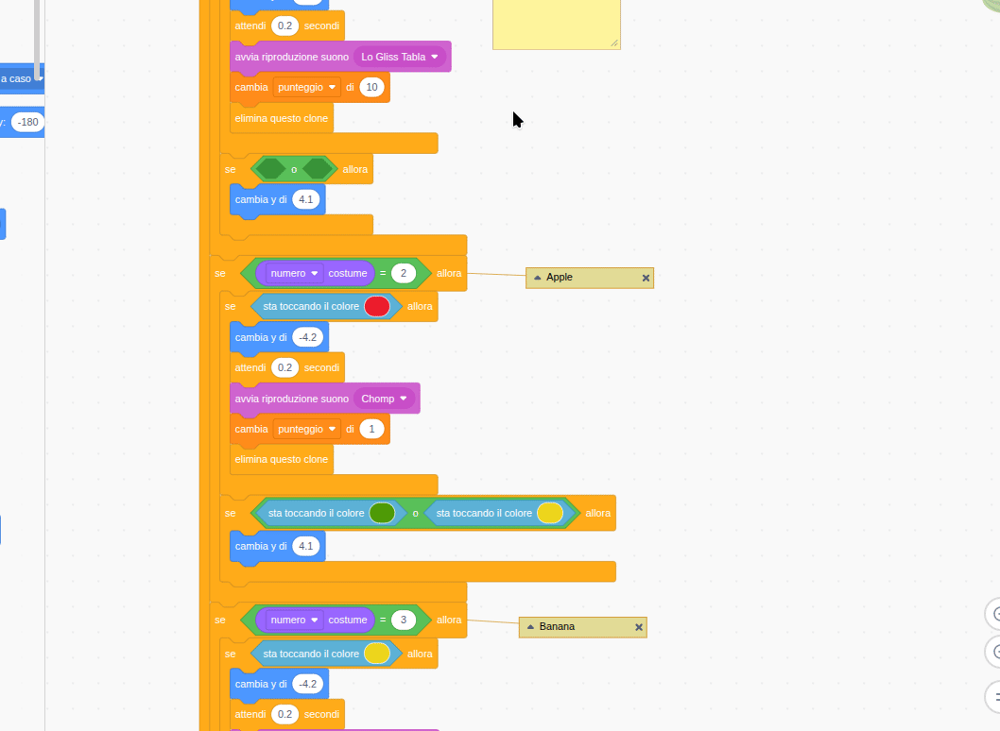
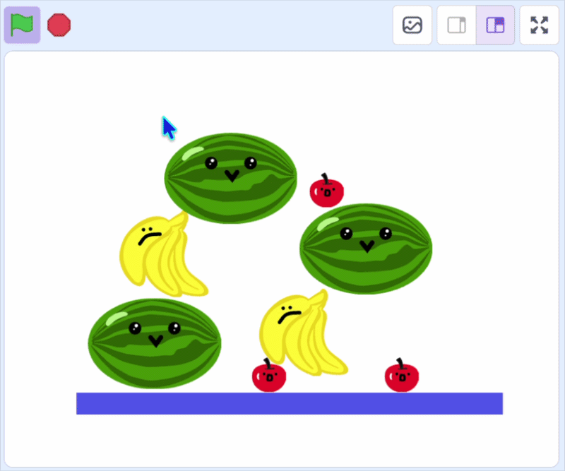

## Crea la pila di frutta

In questa fase, dovrai impilare i frutti che non corrispondono, in modo che la scatola possa riempirsi.

> [!TASK]
>
> {:width="150"}
>
> Per il primo costume da frutta, aggiungi un altro blocco `se`{:class="block3control"} all'interno del controllo `numero del costume`{:class="block3looks"}.
>
> ```blocks3
> if <(costume [numero v]) = (1)> then
> if <sta toccando il colore (#4e9a06)?> then
> change y by (-4.2)
> wait (0.2) seconds
> start sound (Lo Gliss Tabla v)
> delete this clone
> end
> +if <> then
> end
> end
> ```

> [!TASK]
>
> Trascina sopra un blocco `or`{:class="block3operators"}.
>
> ```blocks3
> if <(costume [numero v]) = (1)> then
> if <sta toccando il colore (#4e9a06)?> then
> change y by (-4.2)
> wait (0.2) seconds
> start sound (Lo Gliss Tabla v)
> delete this clone
> end
> +if <<> or <>> then
> end
> end
> ```

> [!TASK]
>
> Quindi aggiungi i blocchi `sta toccando il colore`{:class="block3sensing"} per **tutti gli altri tuoi frutti**.
>
> ```blocks3
> if <(costume [numero v]) = (1)> then
> if <sta toccando il colore (#4e9a06)?> then
> change y by (-4.2)
> wait (0.2) seconds
> start sound (Lo Gliss Tabla v)
> delete this clone
> end
> +if <<sta toccando il colore (#ec1c2c)?> or <sta toccando il colore (#edd51c)?>> then
> end
> end
> ```
>
> Per assicurarti di ottenere i colori giusti, puoi duplicare i blocchi di colore che hai creato nel passaggio precedente.
>
> {:width="350"}

> [!TASK]
>
> Quindi `cambia y`{:class="block3motion"} in modo che il frutto si impili sopra un altro frutto nello stesso modo in cui si fa con il **Pavimento**.
>
> ```blocks3
> if <(costume [numero v]) = (1)> then
> if <sta toccando il colore (#4e9a06)?> then
> change y by (-4.2)
> wait (0.2) seconds
> start sound (Lo Gliss Tabla v)
> delete this clone
> end
> if <<toccando il colore (#ec1c2c)?> or <toccando il colore (#edd51c)?>> then
> +change y by (4.1)
> end
> end
> ```

> [!TASK]
>
> Fai lo stesso per gli altri due costumi, cambiando i due colori per gli **altri due** frutti.

> [!TIP]
>
> Se utilizzi più di 3 frutti, dovrai aggiungere i blocchi `sta toccando il colore`{:class="block3sensing"} per ogni frutto aggiuntivo. Per fare ciò, puoi incorporare altri blocchi `o`{:class="block3operators"}.

**Test:** Clicca sulla bandierina verde per vedere se i diversi frutti ora si impilano in un mucchio e se i frutti dello stesso tipo continuano a scomparire.

{:width="450"}
