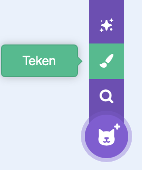
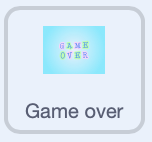
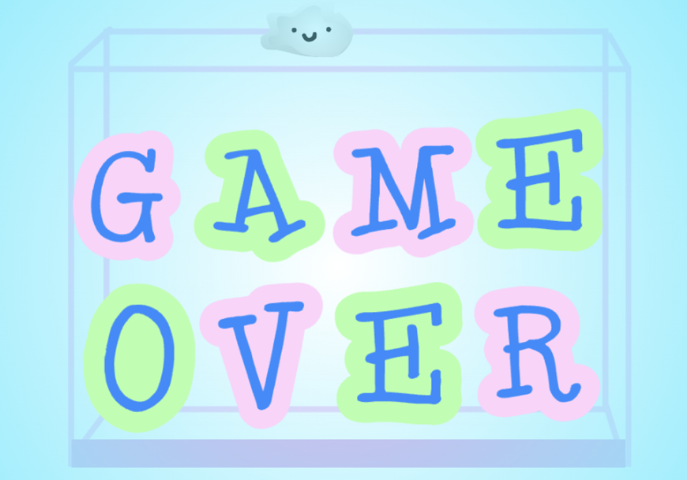

## Voeg een game over toe

Zorg ervoor dat het spel eindigt wanneer de stapel fruit te hoog wordt.

> [!TASK]
>
> {:width="150"}
>
> In het `herhaal`{:class="block3control"}-blok voeg je onderaan nog een `als`{:class="block3control"} blok toe.
>
> Gebruik een `groter dan`{:class="block3operators"} blok en sleep de `y positie`{:class="block3motion"} naar het eerste vak.
>
> ```blocks3
> if <(costume [number v]) = (3)> then
> if <touching color (#edd51c)?> then
> change y by (-4.2)
> wait (0.2) seconds
> start sound (Squish Pop v)
> delete this clone
> end
> end
> +if <(y position) > ()> then
> end
> ```

> [!TASK]
>
> Vul in het tweede vakje het getal in dat je als hoogste punt wilt hebben.
>
> ```blocks3
> +if <(y position) > (111)> then
> end
> ```

> [!TASK]
>
> Als een fruit hoger uitkomt dan dit getal, gebruik dan een`zend signaal en wacht`{:class="block3events"} blok om een `Game over` bericht te sturen.
>
> ```blocks3
> if <(y position) > (111)> then
> +broadcast (Game over v) and wait
> end
> ```

> [!TASK]
>
> Teken een nieuwe sprite en maak je **Game over**-scherm.
>
> {:width="200"}

> [!TASK]
>
> {:width="150"}
>
> Geef het een `groene vlag`{:class="block3events"} blok die het scherm aan het begin verbergt.
>
> ```blocks3
> when green flag clicked
> hide
> ```

> [!TASK]
>
> Laat het vervolgens zien wanneer het bericht 'Game over' verschijnt. Je kunt ook een `geluid`{:class="block3sound"} toevoegen.
>
> ```blocks3
> when I receive (Game over v)
> go to (front v) layer
> show
> play sound (Lose v) until done
> stop (all v)
> ```

**Test:** Klik op de groene vlag en vul de doos tot de bovenkant met fruit: je 'Game over' scherm moet verschijnen en het spel moet stoppen.

{:width="450"}
