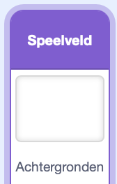

## Meer uitdagingen

Je hebt een compleet spel gemaakt waarbij je fruit laat vallen. Hier zijn nog een paar manieren om er je eigen draai aan te geven. Probeer alles wat je leuk vindt — dat mag je zelf kiezen.

> [!TASK]
>
> ### Muziek en achtergrond toevoegen
>
> {:width="150"}
>
> In het speelveld kies je een achtergrond.
>
> Laat vervolgens een 'geluid\` {class="block3sound"} in een lus afspelen, zodat je spel een soundtrack heeft.
>
> ```blocks3
> when green flag clicked
> forever
> play sound (your track v) until done
> end
> ```

> [!TASK]
>
> ### Voeg een dropper sprite toe
>
> Voeg bovenaan een sprite toe die de muisaanwijzer volgt, zodat de speler kan zien waar het volgende fruit terechtkomt. Het voorbeeldspel maakt gebruik van een wolk. Je zou het ogen en een mond kunnen geven om er een personage van te maken.
>
> Je kunt hiervoor het `maak x`{:class="block3motion"} blok gebruiken.
>
> ```blocks3
> when green flag clicked
> go to x: (-8) y: (159)
> forever
> set x to (mouse x)
> end
> ```

> [!TASK]
>
> ### Voeg een doos of mandje toe
>
> Teken een doos- of mand sprite waar het fruit in kan vallen en plaats het op de achtergrondlaag, zodat het fruit erin blijft liggen.
>
> ```blocks3
> when green flag clicked
> go to (back v) layer
> ```

> [!TASK]
>
> ### Score bijhouden
>
> Voeg een `score`{:class="block3variables"} variabele toe om er meer een spel van te maken.
>
> Stel deze in op `0` wanneer op de groene vlag wordt geklikt, en `verander score met`{:class="block3variables"} net voor elke `verwijder deze kloon `{:class="block3control"}. Geef elke fruitsoort verschillende punten!
>
> ```blocks3
> change [score v] by (10)
> delete this clone
> ```


