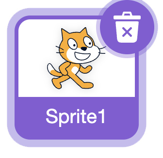
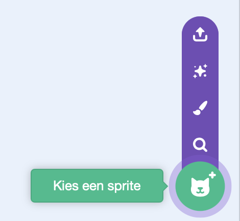
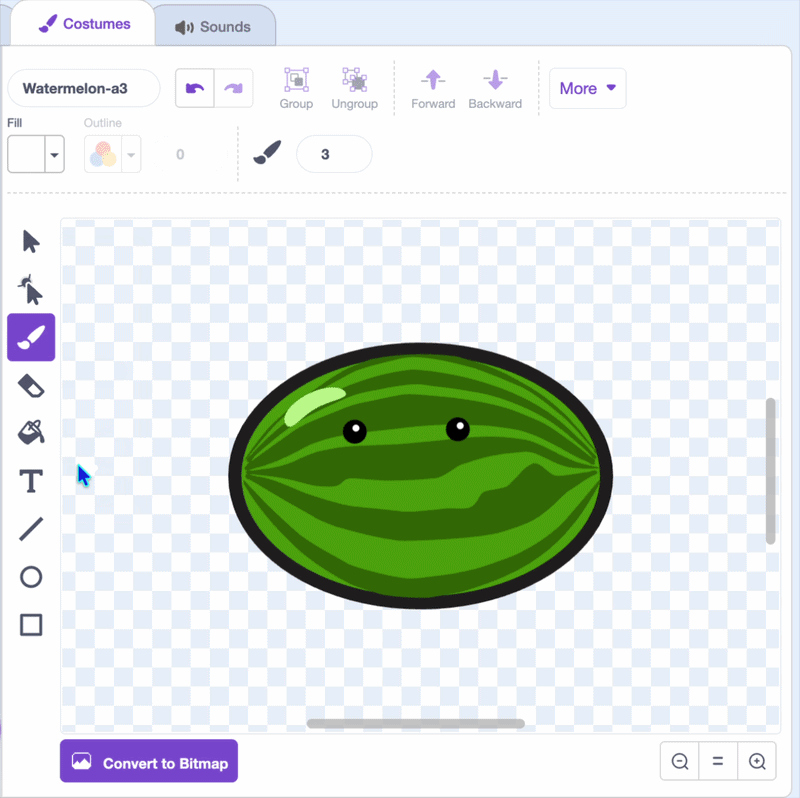
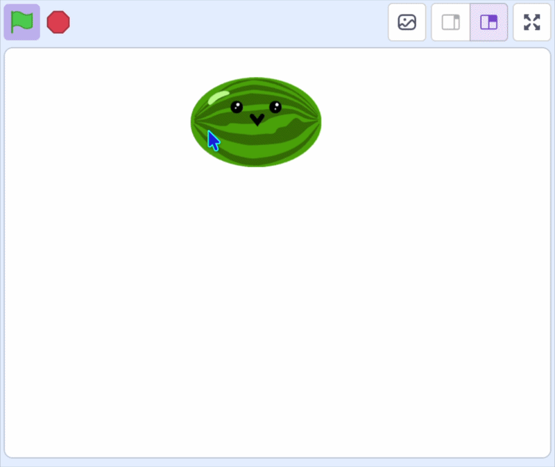

## Voeg je eerste fruit toe

In deze stap voeg je het eerste stuk fruit toe en laat het de muisaanwijzer volgen, klaar om te laten vallen.

> [!TASK]
>
> [Start een nieuw Scratch project](https://scratch.mit.edu/projects/editor/){:target="_blank"}.

> [!TASK]
>
> Verwijder de kat sprite.
>
> {:width="200"}

> [!TASK]
>
> Kies een nieuwe sprite voor je fruit. Je kunt er een uit de bibliotheek kiezen of er zelf een tekenen.
>
> {:width="200"}

> [!TASK]
>
> Gebruik de tekengereedschappen om het een persoonlijkheid te geven: een paar ogen en een mond. Verklein het zodat er een paar op het speelveld passen.
>
> {:width="450"}

> [!TASK]
>
> {:width="150"}
>
> > Plaats het fruit bovenaan het speelveld.
> >
> > Voeg onder de `groene vlag`{:class="block3events"} een `zet sleepbaar op `{:class="block3sensing"} blok toe en kies **niet sleepbaar** in het keuzemenu, zodat spelers het niet kunnen slepen. Voeg dan een `ga naar x: y:`{:class="block3motion"} blok toe.
>
> ```blocks3
> when green flag clicked
> set drag mode [not draggable v]
> go to x: (0) y: (115)
> ```

> [!TASK]
>
> Zorg ervoor dat het fruit de muisaanwijzer volgt.
>
> Plaats het `ga naar x: y:`{:class="block3motion"} blok in een `herhaal`{:class="block3control"} lus en verander de **x**{:class="block3motion"} positie naar de `muis x`{:class="block3sensing"} positie.
>
> ```blocks3
> when green flag clicked
> set drag mode [not draggable v]
> +forever
> go to x: (mouse x) y: (115)
> end
> ```

> [!TASK]
>
> Verplaats het fruit alleen als de muisknop ingedrukt is. Om te beginnen moet je het `ga naar x: y:`{:class="block3motion"} blok in een `als () dan`{:class="block3control"} blok plaatsen.
>
> ```blocks3
> when green flag clicked
> set drag mode [not draggable v]
> forever
> +if <> then
> go to x: (mouse x) y: (115)
> end
> end
> ```

> [!TASK]
>
> Plaats nu een `muis ingedrukt?`{:class="block3sensing"} blok in de zeshoekige sleuf van het `als`{:class="block3control"} blok.
>
> ```blocks3
> when green flag clicked
> set drag mode [not draggable v]
> forever
> +if <mouse down?> then
> go to x: (mouse x) y: (115)
> end
> end
> ```

**Test:** Klik op de groene vlag en klik vervolgens op het speelveld. Je fruit volgt de muisaanwijzer naar links en rechts, maar blijft op dezelfde hoogte.

{:width="450"}
