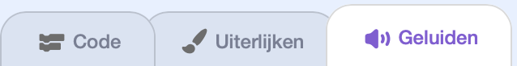
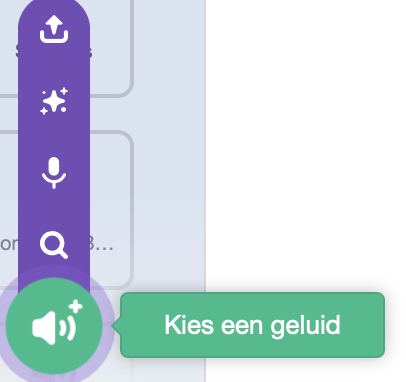
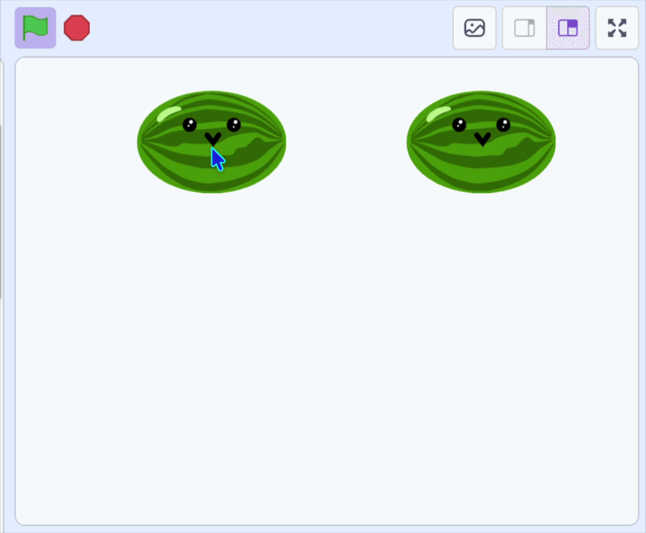

## Kloon het fruit

Het fruit dat je laat vallen zijn **klonen**, of kopieën van de sprite die verschijnt elke keer dat je met de muis klikt.

> [!TASK]
>
> {:width="150"}
>
> Voeg een `maak een kloon van`{:class="block3control"} blok toe dat een kopie maakt telkens wanneer er met de muis wordt geklikt. Er is een korte `wacht`{:class="block3control"} nodig zodat er niet honderden tegelijk verschijnen.
>
> Verwijder het `ga naar x: y:`{:class="block3motion"} blok — de kloon zal het hierna gebruiken.
>
> ```blocks3
> when green flag clicked
> set drag mode [not draggable v]
> forever
> if <mouse down?> then
> +create clone of (myself v)
> +wait (0.1) seconds
> end
> end
> ```

> [!TASK]
>
> Vertel elke kloon wat hij moet doen als hij verschijnt.
>
> Voeg een `wanneer ik als kloon start`{:class="block3control"} blok toe en sleep het `ga naar x: y:`{:class="block3motion"} blok er onder.
>
> ```blocks3
> when I start as a clone
> go to x: (mouse x) y: (115)
> ```

> [!TASK]
>
> Kies een geluid voor het moment dat je het fruit laat vallen.
>
> Voeg eerst een nieuw geluid toe in het tabblad **Geluiden**.
>
> {:width="450"}

> [!TASK]
>
> Klik op 'Kies een geluid' en selecteer er een uit de bibliotheek.
>
> {:width="200"}

> [!TASK]
>
> Voeg vervolgens een `start geluid`{:class="block3sound"} blok toe en selecteer je geluid uit het keuzelijstmenu.
>
> ```blocks3
> when I start as a clone
> go to x: (mouse x) y: (115)
> +start sound (Pop v)
> ```

**Test:** klik op de groene vlag en klik vervolgens op het speelveld om te controleren of er een nieuw stuk fruit verschijnt met een plopgeluid.

{:width="450"}
