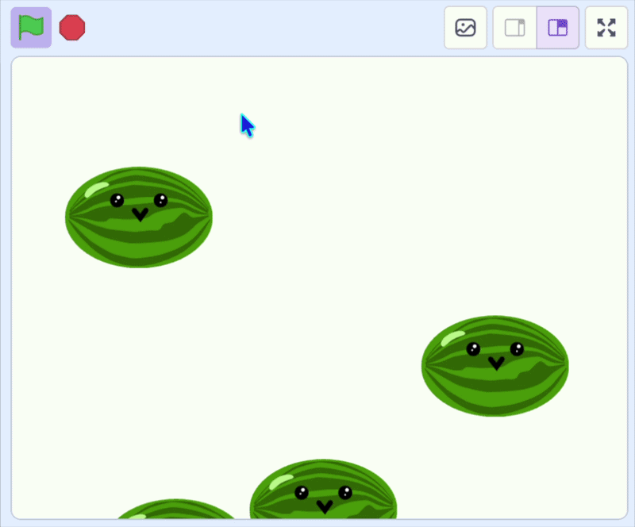

## Laat ze vallen

In deze stap laat je het fruit op het scherm naar beneden vallen.

> [!TASK]
>
> {:width="150"}
>
> Voeg een `herhaal`{:class="block3control"} lus toe in `wanneer ik als kloon start`{:class="block3control"} en laat dit fruit vallen door de `y`{:class="block3motion"} positie te veranderen.
>
> ```blocks3
> when I start as a clone
> go to x: (mouse x) y: (115)
> start sound (Pop v)
> +forever
> change y by (-4)
> end
> ```

**Test:** Klik op de groene vlag en probeer wat fruit te laten vallen. Je fruit moet vallen, maar het originele fruit moet ook bovenaan verschijnen.

> [!TASK]
>
> Voeg `verdwijn`{:class="block3looks"} en `verschijn`{:class="block3looks"} blokken toe om alleen de klonen te laten verschijnen.
>
> Verberg het originele fruit:
>
> ```blocks3
> when green flag clicked
> set drag mode [not draggable v]
> +hide
> forever
> if <mouse down?> then
> create clone of (myself v)
> wait (0.1) seconds
> end
> end
> ```
>
> En laat de nieuwe kloon verschijnen.
>
> ```blocks3
> when I start as a clone
> go to x: (mouse x) y: (115)
> start sound (Pop v)
> +show
> forever
> change y by (-4)
> end
> ```

**Test:** Klik op de groene vlag en laat wat fruit vallen. Controleer of elk stuk naar beneden valt en of het oorspronkelijke fruit verborgen is.

{:width="450"}
