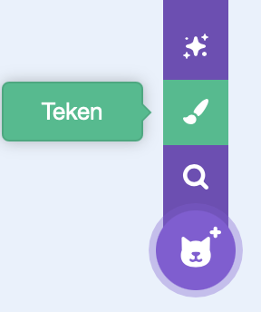
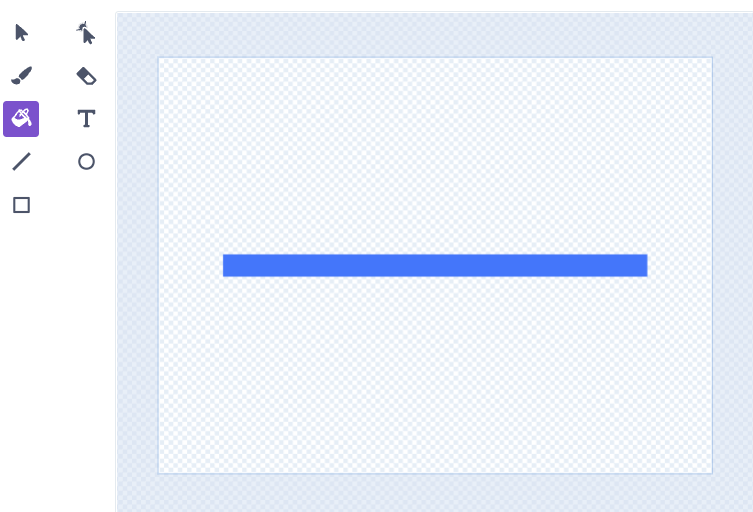
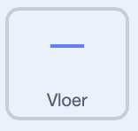
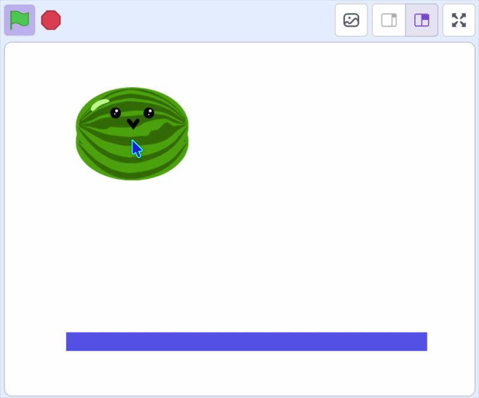

## Laat ze landen

Voeg een vloer toe en laat het fruit erop landen.

> [!TASK]
>
> Kies in het pictogram voor het toevoegen van een sprite de optie **Teken** om een nieuwe sprite te tekenen en geef deze de naam **Vloer**.
>
> {:width="200"}

> [!TASK]
>
> Gebruik de gereedschappen om een lijn of een rechthoek over het midden van het tekengebied te tekenen. Dit is de vloer waarop je fruit komt te liggen.
>
> {:width="450"}

> [!TASK]
>
> {:width="150"}
>
> Verplaats de **Vloer** sprite naar de onderkant van het speelveld.
>
> Voeg een `wanneer op groene vlag wordt geklikt`{:class="block3events"} blok toe, met een `zet sleepbaar op`{:class="block3sensing"} blok en een `ga naar x: y:`{:class="block3motion"} blok om het op de gewenste positie te plaatsen.
>
> ```blocks3
> when green flag clicked
> set drag mode [not draggable v]
> go to x: (0) y: (-125)
> ```

> [!TASK]
>
> {:width="150"}
>
> Klik op de **fruit**-sprite en voeg een `als`{:class="block3control"}-blok toe om te controleren of de kloon de vloer `raakt`{:class="block3sensing"}. Als het de vloer raakt, zal het omhoog gaan door `maak`{:class="block3motion"} **y** een grotere waarde te geven.
>
> ```blocks3
> forever
> change y by (-4)
> +if <touching (Floor v)?> then
> change y by (4.1)
> end
> end
> ```
>
> > [!TIP]
> >
> > Het fruit valt telkens 4 centimeter naar beneden en springt vervolgens weer 4,1 centimeter omhoog wanneer het de grond raakt. Die twee getallen heffen elkaar vrijwel op, waardoor het lijkt alsof het fruit wiebelt.

**Test:** Klik op de groene vlag en controleer of het fruit valt en op de vloer terechtkomt.

{:width="450"}
