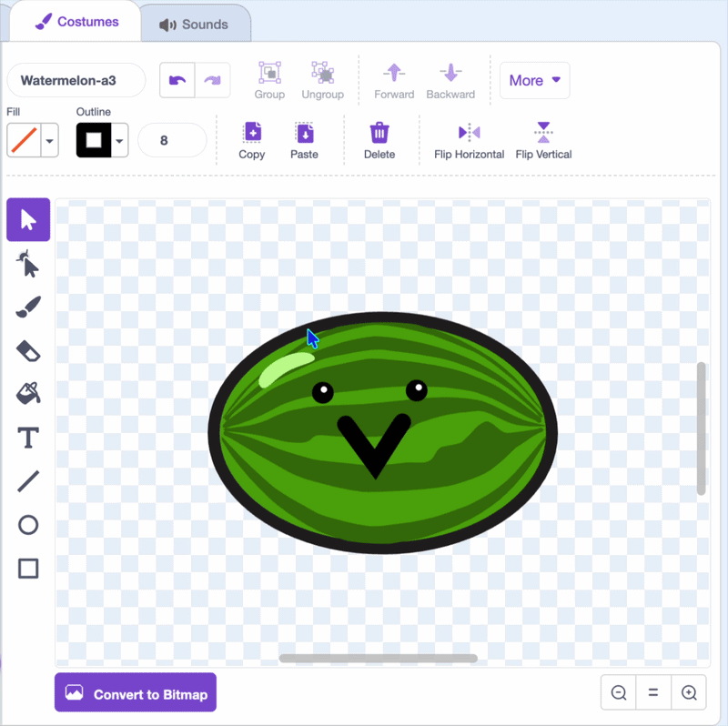
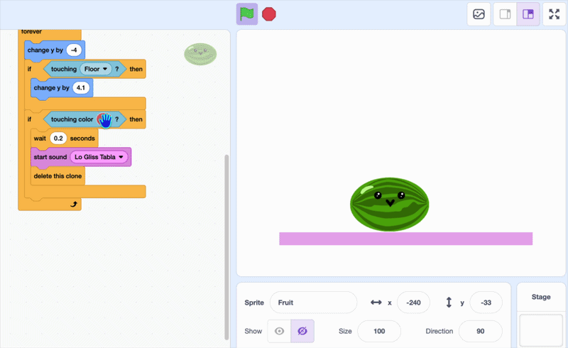
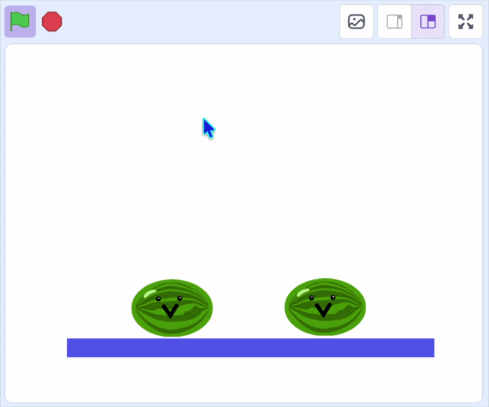

## Laat het fruit verdwijnen

En nu het interactieve gedeelte!

In deze stap gebruik je `raak ik kleur`{:class="block3sensing"} om fruit te laten verdwijnen als het elkaar aanraakt.

> [!TASK]
>
> {:width="150"}
>
> In de **tekeneditor** kun je de omtrek van je **fruit sprite** aanpassen aan de hoofdkleur van het fruit, of een omtrek in één kleur er omheen tekenen.
>
> {:width="450"}

> [!TASK]
>
> Voeg `als`{:class="block3control"} en `raak ik kleur `{:class="block3sensing"} blokken toe binnen de `herhaal`{:class="block3control"} lus.
>
> ```blocks3
> when I start as a clone
> go to x: (mouse x) y: (115)
> start sound (Pop v)
> show
> forever
> change y by (-4)
> if <touching (Floor v)?> then
> change y by (4.1)
> end
> +if <touching color ()?> then
> end
> end
> ```

> [!TASK]
>
> Om de exacte kleur te krijgen, klik je op het kleurenvak in `raak ik kleur`{:class="block3sensing"} en kies het pipetje om deze te selecteren uit je fruit.
>
> {:width="450"}

> [!TASK]
>
> Voeg een `verander y met`{:class="block3motion"} blok en `wacht x sec.`{:class="block3control"} blok toe zodat het fruit beweegt en even wacht om de kleuren te detecteren.
>
> ```blocks3
> forever
> change y by (-4)
> if <touching (Floor v)?> then
> change y by (4.1)
> end
> if <touching color (#4e9a06)?> then
> +change y by (-4.2)
> +wait (0.2) seconds
> end
> end
> ```

> [!TASK]
>
> Voeg een `start geluid`{:class="block3sound"} blok toe en kies een geluid dat bij je fruit past.
>
> ```blocks3
> forever
> change y by (-4)
> if <touching (Floor v)?> then
> change y by (4.1)
> end
> if <touching color (#4e9a06)?> then
> change y by (-4.2)
> wait (0.2) seconds
> +start sound (Lo Gliss Tabla v)
> end
> end
> ```

> [!TASK]
>
> Laat dan beide klonen verdwijnen met `verwijder deze kloon`{:class="block3control"}.
>
> ```blocks3
> forever
> change y by (-4)
> if <touching (Floor v)?> then
> change y by (4.1)
> end
> if <touching color (#4e9a06)?> then
> change y by (-4.2)
> wait (0.2) seconds
> start sound (Lo Gliss Tabla v)
> +delete this clone
> end
> end
> ```

**Test:** Klik op de groene vlag en laat twee vruchten op dezelfde plek vallen. Als ze elkaar aanraken, moeten ze een geluid laten horen en verdwijnen.

{:width="450"}

