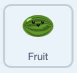
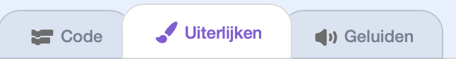
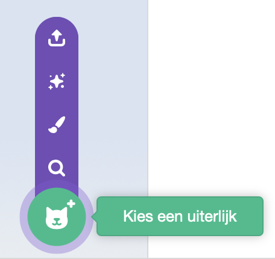
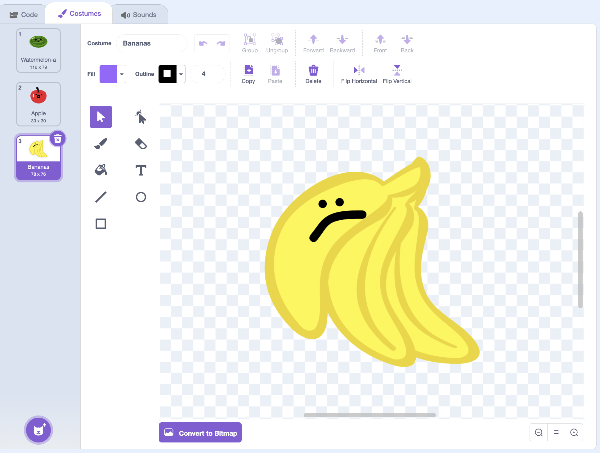

## Voeg meer fruit toe

In deze stap voeg je meer fruit toe!

> [!TASK]
>
> {:width="150"}
>
> Klik op het tabblad **Uiterlijken** van je fruit sprite.
>
> {:width="450"}

> [!TASK]
>
> Voeg een nieuw uiterlijk toe voor elke nieuwe fruitsoort die je wilt. Om het eenvoudig te houden, probeer er eerst een of twee toe te voegen.
>
> {:width="200"}

> [!TASK]
>
> Zorg ervoor dat de nieuwe vruchten een **effen omtrek** hebben, net als je eerste vrucht.
>
> {:width="450"}

> [!TIP]
>
> Als je sprite extra uiterlijken bevat die je niet wilt houden, verwijder ze. Anders zullen ze ook in het spel verschijnen.

> [!TASK]
>
> Voeg nu een `verander uiterlijk naar`{:class="block3looks"} blok toe en sleep het `willekeurig getal tussen`{:class="block3operators"} blok erin. Hierdoor wordt er elke keer een willekeurig uiterlijknummer gekozen, zodat er een andere vrucht verschijnt.
>
> ```blocks3
> when I start as a clone
> +switch costume to (pick random (1) to (3))
> go to x: (mouse x) y: (115)
> start sound (Pop v)
> show
> forever
> change y by (-4)
> if <touching (Floor v)?> then
> change y by (4.1)
> end
> if <touching color (#4e9a06)?> then
> change y by (-4.2)
> wait (0.2) seconds
> start sound (Lo Gliss Tabla v)
> delete this clone
> end
> end
> ```
>
> Vul de willekeurige getallen in voor het aantal uiterlijken dat je hebt.

**Test:** Klik op de groene vlag en klik vervolgens met de muis om te controleren of er elke keer een willekeurige fruitsoort verschijnt.
