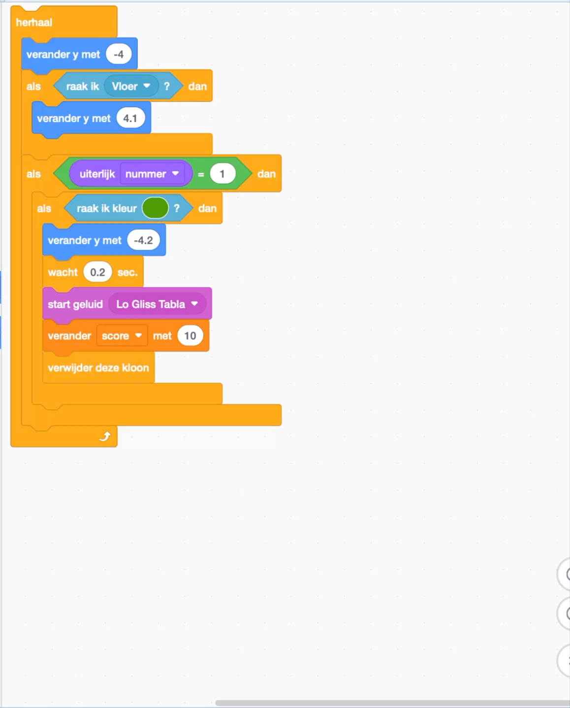
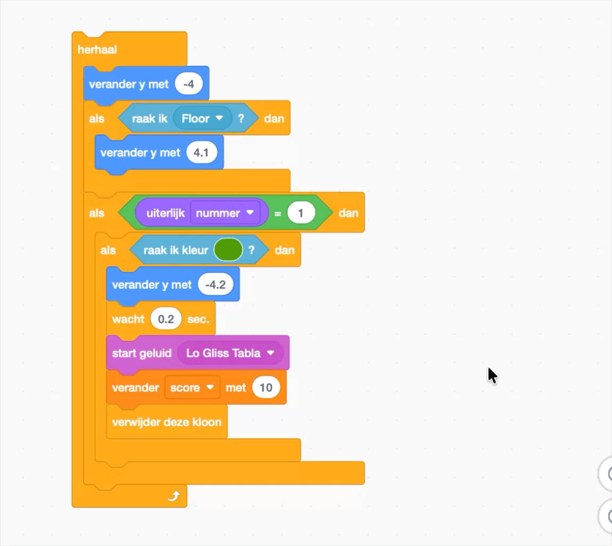

## Laat al het fruit verdwijnen

In deze stap laat je alle vruchten verdwijnen zodra ze overeenkomen.

> [!TASK]
>
> {:width="150"}
>
> Voeg nog een `als`{:class="block3control"} blok toe en plaats het `als`{:class="block3control"} blok met `raak ik kleur `{:class="block3sensing"} blok erin.
>
> ```blocks3
> when I start as a clone
> switch costume to (pick random (1) to (3))
> go to x: (mouse x) y: (115)
> start sound (Pop v)
> show
> forever
> change y by (-4)
> if <touching (Floor v)?> then
> change y by (4.1)
> end
> +if < > then
> if <touching color (#4e9a06)?> then
> change y by (-4.2)
> wait (0.2) seconds
> start sound (Lo Gliss Tabla v)
> delete this clone
> end
> end
> end
> ```

> [!TASK]
>
> {:width="150"}
>
> Gebruik een `gelijk aan`{:class="block3operators"} en sleep het `uiterlijk nummer`{:class="block3looks"} erin. Hiermee wordt gecontroleerd of het uiterlijknummer '1' is.
>
> ```blocks3
> forever
> change y by (-4)
> if <touching (Floor v)?> then
> change y by (4.1)
> end
> +if <(costume [number v]) = (1)> then
> if <touching color (#4e9a06)?> then
> change y by (-4.2)
> wait (0.2) seconds
> start sound (Lo Gliss Tabla v)
> delete this clone
> end
> end
> end
> ```

> [!TASK]
>
> Klik met de rechtermuisknop en **dupliceer** het blok, zodat je dit voor alle fruitsoorten kunt toepassen. De nieuwe blokken moeten onder het laatste blok komen te staan, en binnen de `herhaal`{:class="block3control"} lus.
>
> {:width="450"}

> [!TASK]
>
> Verander de `gelijk aan`{:class="block3operators"} in `2` en gebruik het pipetgereedschap voor de kleur van je **tweede** uiterlijk. Je kunt ook een ander geluid kiezen als je wilt.
>
> ```blocks3
> forever
> change y by (-4)
> if <touching (Floor v)?> then
> change y by (4.1)
> end
> if <(costume [number v]) = (1)> then
> if <touching color (#4e9a06)?> then
> change y by (-4.2)
> wait (0.2) seconds
> start sound (Lo Gliss Tabla v)
> delete this clone
> end
> end
> +if <(costume [number v]) = (2)> then
> if <touching color (#ec1c2c)?> then
> change y by (-4.2)
> wait (0.2) seconds
> start sound (Chomp v)
> delete this clone
> end
> end
> end
> ```

> [!TASK]
>
> Herhaal dit vervolgens nog een keer voor je **derde** vrucht. Voeg `gelijk aan`{:class="block3operators"} toe aan `3` en gebruik het pipetje om die kleur te selecteren.
>
> ```blocks3
> +if <(costume [number v]) = (3)> then
> if <touching color (#edd51c)?> then
> change y by (-4.2)
> wait (0.2) seconds
> start sound (Squish Pop v)
> delete this clone
> end
> end
> ```

> [!TIP]
>
> Voorkom dat je het overzicht verliest van alle blokken. Klik met de rechtermuisknop en kies **Commentaar toevoegen** om elk item te labelen met de naam van de betreffende vrucht.

{:width="450"}

Klik op de groene vlag om te **testen**. Elke vrucht moet verdwijnen zodra het een ander stuk fruit van dezelfde kleur aanraakt.
