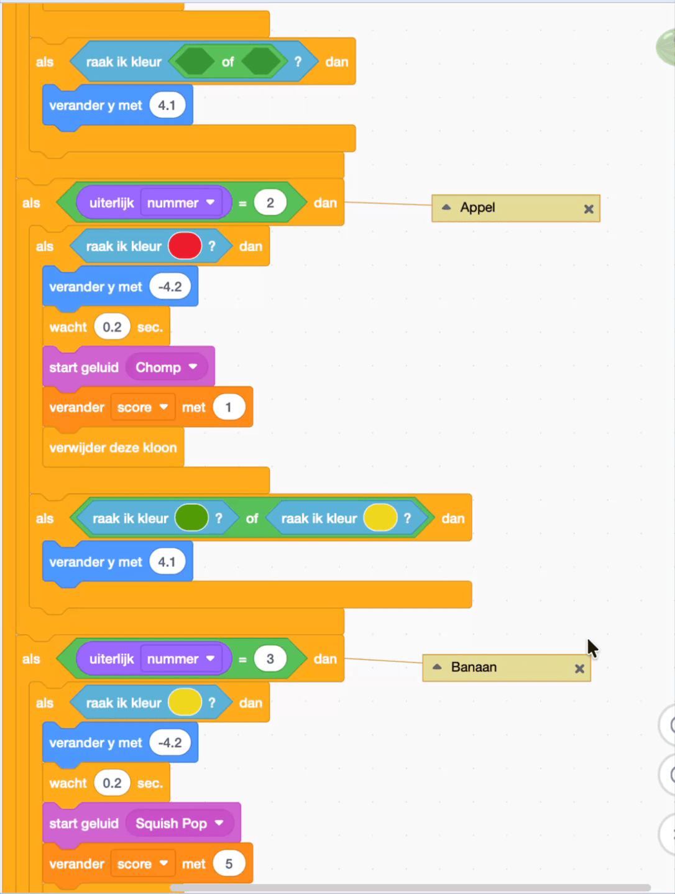
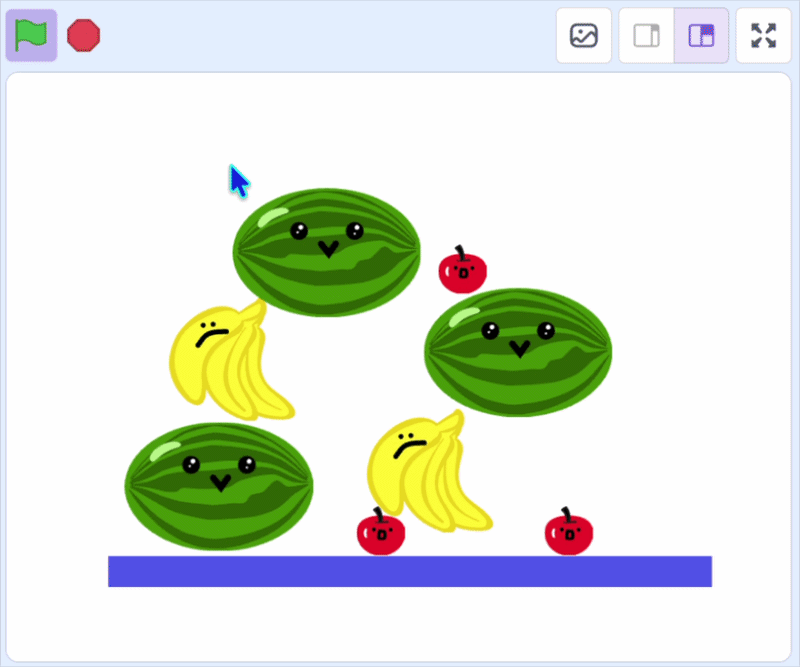

## Laat het fruit opstapelen

In deze stap stapel je de vruchten op elkaar als ze niet bij elkaar passen, zodat de doos gevuld kan worden.

> [!TASK]
>
> {:width="150"}
>
> Voor het eerste fruit uiterlijk, voeg een extra `als`{:class="block3control"} blok toe binnen de `uiterlijk nummer`{:class="block3looks"} controle.
>
> ```blocks3
> if <(costume [number v]) = (1)> then
> if <touching color (#4e9a06)?> then
> change y by (-4.2)
> wait (0.2) seconds
> start sound (Lo Gliss Tabla v)
> delete this clone
> end
> +if <> then
> end
> end
> ```

> [!TASK]
>
> Sleep een `of`{:class="block3operators"} blok eroverheen.
>
> ```blocks3
> if <(costume [number v]) = (1)> then
> if <touching color (#4e9a06)?> then
> change y by (-4.2)
> wait (0.2) seconds
> start sound (Lo Gliss Tabla v)
> delete this clone
> end
> +if <<> or <>> then
> end
> end
> ```

> [!TASK]
>
> Voeg vervolgens `raak ik kleur`{:class="block3sensing"} blokken toe voor **al je andere fruitsoorten**.
>
> ```blocks3
> if <(costume [number v]) = (1)> then
> if <touching color (#4e9a06)?> then
> change y by (-4.2)
> wait (0.2) seconds
> start sound (Lo Gliss Tabla v)
> delete this clone
> end
> +if <<touching color (#ec1c2c)?> or <touching color (#edd51c)?>> then
> end
> end
> ```
>
> Om er zeker van te zijn dat je de juiste kleuren krijgt, kun je de kleurvlakken die je in de vorige stap hebt gemaakt, kopiëren.
>
> {:width="350"}

> [!TASK]
>
> Vervolgens `maak y`{:class="block3motion"} zodat het fruit op hetzelfde niveau op een ander fruit wordt gestapeld als bij de **Vloer**.
>
> ```blocks3
> if <(costume [number v]) = (1)> then
> if <touching color (#4e9a06)?> then
> change y by (-4.2)
> wait (0.2) seconds
> start sound (Lo Gliss Tabla v)
> delete this clone
> end
> if <<touching color (#ec1c2c)?> or <touching color (#edd51c)?>> then
> +change y by (4.1)
> end
> end
> ```

> [!TASK]
>
> Doe hetzelfde voor je andere twee uiterlijken, en verander de twee kleuren voor de **twee andere** vruchten.

> [!TIP]
>
> Als je meer dan 3 vruchten gebruikt, moet je voor elke extra vrucht de blokken `raak ik kleur`{:class="block3sensing"} toevoegen. Je kunt meer `of`{:class="block3operators"} blokken insluiten om dit te doen.

**Test:** Klik op de groene vlag om te zien of verschillende soorten fruit nu op een hoopje liggen en of bijpassende vruchten nog steeds verdwijnen.

{:width="450"}
